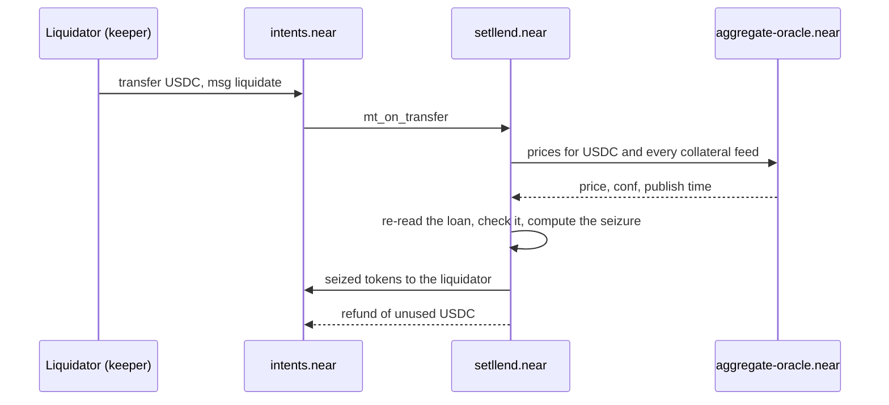

import LiquidationCalculator from '@site/src/components/calculators/LiquidationCalculator';

A **liquidation** repays some or all of a borrower's debt and gives the liquidator collateral worth that amount plus a **liquidation bonus**. It protects lenders in two situations: when the collateral is losing value faster than the debt can be covered, and when a borrower simply doesn't repay at maturity. The USDC the liquidator pays goes into the maturity's redemption pool, where lenders redeem it.

## When a loan can be liquidated

A loan with debt can be liquidated when either is true:

1. **Unhealthy:** its [health factor](./collateral-and-health.mdx) is below 1, at conservative prices (collateral at `price − conf`, USDC at `price + conf`). This can happen at any time.
2. **Overdue:** it is still unpaid at **maturity + 1 hour** (the grace period). From then on it can be liquidated whatever its health.

The contract checks overdue first. There is no separate settlement step at maturity: settling an unpaid loan is a liquidation, so one well-tested code path handles both cases. The cost of this design is that settlement depends on a liquidator showing up and on a fresh oracle price, which is why the operator runs a keeper around the clock.

## Who liquidates

**Anyone** can liquidate. A liquidator sends USDC from their Intents balance to `setllend.near` with a `transfer` intent whose `msg` is:

```json
{"action": "liquidate", "data": {"borrower": "0xabc…", "maturity": "1795766400000000000"}}
```

The amount sent is what the liquidator offers to repay. The contract takes at most what the liquidation needs and refunds the rest in the same transaction.

The Setllend backend runs a **keeper** from the account `backend.setllend.near`. Every 10 seconds it reads every loan from the contract, checks it with the same math and price rules as the contract, and liquidates the eligible ones one at a time: overdue loans first, then the lowest health. It sends `min(its USDC, the debt face)`, so with little capital it liquidates part of a loan and comes back later. It liquidates every eligible loan, even dust loans where gas costs more than the bonus, so small loans don't sit unliquidated waiting for someone who finds them worth the gas.

## How much is seized

**Close factor 100%.** A single liquidation may repay the whole debt. The liquidator chooses how much to repay, up to the debt face.

**Same fraction of every token.** If the loan holds several collateral tokens, the contract takes the same fraction of each, so the loan's mix stays the same. With the 5% bonus every token has today, the collateral seized is worth the repaid USDC × 1.05.

**Mid prices.** Whether a loan is liquidatable is decided at conservative prices, but how much is seized is computed at the oracle's mid price, without `conf`, as Aave does. The conservative check protects lenders by acting early; the mid price pays the liquidator a fair amount, neither inflated nor cut by the width of the confidence interval.

The contract's formula, with `value_i` each token's value at mid price:

```
V          = Σ value_i
W          = Σ value_i × (1 + liq_bonus_i)
repaid_usd = repaid × USDC price

f          = repaid_usd × W / V²          (fraction taken from every token)
seized_i   = amount_i × f                 (rounded down per token)
```

- Each token's share rounds **down**, against the liquidator. A token whose share rounds to 0 is skipped; the call fails only if nothing at all would be seized.
- **Capped at everything.** If `f` reaches 1, the collateral isn't worth the debt plus the bonus. The liquidator then receives all of every token and repays only what it is worth, `V² / W` in USD (that is `V / 1.05` with equal bonuses), rounded up. Whatever debt is left becomes [bad debt](./bad-debt.md).

Each seized token is paid to the liquidator's Intents balance with its own transfer. Any collateral left stays in the loan, and once the debt is zero the borrower can withdraw it without a price check.

## The flow



Before the oracle call, the contract checks that the token is USDC and the loan exists with debt. After it, the callback reads the loan again, since a repayment or another liquidation may have landed in between. If the loan no longer qualifies, the call fails and the liquidator is refunded in full. The failure reasons, as the contract writes them:

| Reason | Meaning |
|---|---|
| `No loan` | No loan for this borrower and maturity |
| `No debt` | The loan has no debt left |
| `No price` | A price for USDC or any token of the loan, frozen ones included, is stale or fails validation |
| `Loan is not liquidatable` | Health factor at or above 1 and not overdue |
| `Nothing to seize` | Every token's share rounds to 0 |

A fresh price is needed even for an overdue loan, because the seizure is computed from prices. While the [oracle](./oracle.md) is stale, liquidations wait.

## Worked examples

All three use a loan with **70 USDC of debt face**, a liquidation threshold of 80%, and a 5% bonus, backed by 0.05 ETH (examples 1 and 3) or 0.1 ETH (example 2). USDC is taken at $1.00.

**1. Price falls.** The health factor reaches 1 when 0.05 × price × 0.80 = 70, so at ETH ≈ **$1,750** at mid price. Because the contract subtracts `conf` from the ETH price and adds it to the USDC price, it actually triggers a little earlier: with a conf of $2.50 on ETH and $0.0014 on USDC, at about $1,755. At $1,750 a keeper repays all 70 USDC and receives 70 × 1.05 / 1,750 = **0.042 ETH** ($73.50). The borrower's debt is 0 and they keep **0.008 ETH** ($14), which they can withdraw. The liquidator earns $3.50 minus gas.

**2. Unpaid at maturity.** This time the 70 USDC loan holds 0.1 ETH at $2,260, a healthy loan. The borrower doesn't repay. At maturity + 1 hour it becomes overdue, and a keeper repays 70 USDC and receives 73.50 / 2,260 ≈ **0.032522 ETH**. The borrower keeps about 0.067478 ETH ($152.50). Missing maturity cost them the 5% bonus, $3.50, on top of the debt.

**3. Price falls too far.** Before anyone liquidates, ETH drops to $1,400. The 0.05 ETH is now worth $70, less than 70 × 1.05 = $73.50, so the seizure is capped: the keeper receives all 0.05 ETH and repays 70 / 1.05 ≈ **66.666667 USDC**. The remaining **3.333333 USDC** of debt is realized as bad debt and shared by that maturity's note holders. The price where this begins is 70 × 1.05 / 0.05 = **$1,470**.

## Try it

<LiquidationCalculator />

The calculator values one collateral token at mid prices. The contract decides when to liquidate at conservative prices, so in practice it triggers slightly above the liquidation price shown.

## How to avoid liquidation

- Keep the health factor well above 1. Add collateral or repay part of the debt when it falls.
- Repay, or buy back notes in the same maturity, before **maturity + 1 hour**. After that, only a liquidation closes the loan, and it costs the bonus.
- Remember that the owner can change a token's liquidation threshold at once, open loans included.

Steps in the app: [Manage a loan](../guides/manage-loan.md).
