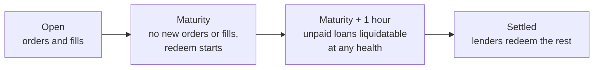

A **maturity** is the fixed date and time at which a set of notes pays out and the matching loans are due. Setllend doesn't let each borrower pick an end date. Instead, the contract owner lists a few maturities, and every order, note, and loan belongs to exactly one of them. Each maturity has its own [order book](./order-book.md), its own note pool, and its own redemption pool.

## Why fixed dates

If every loan could end on any day, liquidity would spread across hundreds of thin books, and a lender who wanted to sell a note would rarely find a buyer for that exact date. A few fixed dates put every lender and borrower for a period on the same book, so orders meet more often and prices are easier to read. Fixed-rate protocols such as Notional and Pendle use the same pattern.

It also isolates risk. A loan belongs to one borrower and one maturity, with no cross-margin across maturities, so a default in one maturity never touches notes in another.

## Maturities on the contract

All maturities are at 08:00 UTC. The contract stores them as nanosecond timestamps.

| Maturity (UTC) | Timestamp (ns) |
|---|---|
| 2026-11-08 08:00 | `1794124800000000000` |
| 2026-11-13 08:00 | `1794556800000000000` |
| 2026-11-27 08:00 | `1795766400000000000` |
| 2026-12-25 08:00 | `1798185600000000000` |

The `get_maturities` view returns every maturity, past and future; clients compare them with the current time. The owner adds new ones with `add_maturity`, which only accepts a time in the future that isn't listed yet. Maturities are never removed, so a passed maturity stays readable and its loans and notes keep working. The current list is also on [Risk parameters](../reference/risk-parameters.md#maturities).

## The life of a maturity

**Before maturity.** Lenders and borrowers place orders, the matcher fills them, and loans and notes are created. Lenders can sell notes, borrowers can repay, add collateral, or withdraw collateral their loan doesn't need. A loan whose [health factor](./collateral-and-health.mdx) falls below 1 can be liquidated at any time.

**At maturity.** The book stops: no new orders can be placed and no fills happen, because there is no time left to earn interest. Orders still resting on the book stay there until their owner cancels them. Note holders can start to [redeem](../guides/redeem.md) from the redemption pool. Borrowers can still repay.

**During the grace period.** For **1 hour** after maturity, a borrower who hasn't repaid can still repay or add collateral without being liquidated for being late.

**From maturity + 1 hour.** Any loan with debt left is overdue and can be [liquidated](./liquidation.mdx) whatever its health. This is how maturity settles: a liquidator repays the debt and receives collateral plus the liquidation bonus, and the USDC they pay goes into the redemption pool for lenders. From this point a borrower can no longer add collateral (it would only go to the liquidator) or withdraw collateral against the debt. Repaying is still allowed until the loan is liquidated.

:::warning Open orders don't close themselves
An order that hasn't filled by maturity stays on the book with its escrow, but it can never fill. Cancel it to get your USDC, collateral, or notes back. Cancelling is allowed at any time.
:::

## What you can do, and when

| Action | Before maturity | Maturity to maturity + 1 hour | After maturity + 1 hour |
|---|---|---|---|
| Place `lend`, `borrow`, `sell_note` orders | Yes | No | No |
| Fills | Yes | No | No |
| Cancel an order | Yes | Yes | Yes |
| Repay | Yes | Yes | Yes, while debt remains |
| Add collateral (loan with debt) | Yes | Yes | No |
| Withdraw collateral, loan with debt | Yes, if the loan still meets max LTV | Yes, if the loan still meets max LTV | No |
| Withdraw collateral, loan without debt | Yes | Yes | Yes |
| Redeem notes | No | Yes | Yes |
| Liquidate an unhealthy loan | Yes | Yes | Yes |
| Liquidate an unpaid loan at any health | No | No | Yes |

## Time to maturity sets the interest

Interest is simple interest for the exact time left between the fill and the maturity, counted in nanoseconds (see [Rates and prices](./rates-and-prices.mdx)). The same APR therefore earns less the closer the fill is to maturity. A 1,000 USDC fill at 8% APR is worth:

| Time left at the fill | Note value at maturity |
|---|---|
| 21 days | 1,004.60 USDC |
| 7 days | 1,001.53 USDC |
| 1 day | 1,000.22 USDC |

Seen the other way, the price of a note rises toward 1 USDC per 1 USDC of value as maturity approaches, even when the rate on the book doesn't move.
