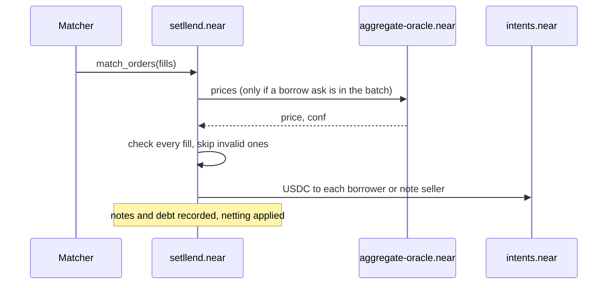

Each [maturity](./maturities.md) has one central limit order book. Lenders post bids, borrowers and note sellers post asks, all quoted in [APR](./rates-and-prices.mdx). An off-chain **matcher** finds orders that cross and sends them to the contract, which checks every fill and settles it. Every order's funds sit in escrow on the contract from the moment it is placed, so the book can always be rebuilt from the contract's state.

## Three kinds of order

| Order | Side | Escrow | Limit | Size |
|---|---|---|---|---|
| `lend` | bid: buys notes | USDC, the amount transferred | `min_rate_bps` | Principal: the escrowed USDC |
| `borrow` | ask: issues new notes | One or more collateral tokens, or none when borrowing against a loan's existing collateral | `max_rate_bps` | `principal`: the USDC the borrower wants |
| `sell_note` | ask: sells existing notes | Note shares, locked from the seller's free balance | `max_rate_bps` | The notes to sell, entered as a value and locked as shares |

Placing an order is one signed intent on NEAR Intents:

- `lend` and `borrow` are a `transfer` intent that sends the escrow from your Intents balance to `setllend.near` with the order in its `msg`. The funds and the order arrive together; an invalid order is refunded in full.
- `sell_note`, and a `borrow` against collateral already in your loan, are an `auth_call` intent: nothing is transferred, the contract locks your note shares or uses your loan's collateral.

An order is accepted if its maturity is listed and still in the future, its optional expiry is in the future, and its amount is above zero. There is no minimum or maximum size, no limit on the number of orders, and no rate range. Collateral is not checked when a `borrow` order is placed; it is checked at each fill.

## Price-time priority

Orders are ranked by rate first, then by age:

- **Best bid:** the `lend` order with the **lowest** minimum rate, the cheapest money for a borrower.
- **Best ask:** the `borrow` or `sell_note` order with the **highest** maximum rate, the best return for a lender.
- **Ties:** the lower `order_id` goes first. Order IDs are sequential and never reused, so they record the order in which the contract accepted orders.

A bid and an ask **cross** when `bid.min_rate_bps ≤ ask.max_rate_bps`.

## Fills happen at the maker's rate

When two orders cross, the fill rate is the limit rate of the **maker**, the order that was placed first (the lower `order_id`). The newer order, the **taker**, gets that rate or better. The matcher only chooses which orders to pair and how much to fill; it never sends a rate, and the contract computes the rate itself from the two orders. This is the standard rule on order books, and it leaves the operator no choice over the price anyone gets.

**Example.** A lender's bid of 1,000 USDC at a minimum of 7.00% (order 41) is resting on the book. A borrower then places an ask for 600 USDC at a maximum of 8.00% (order 42). The orders cross because 7.00% ≤ 8.00%. Order 41 is the maker, so 600 USDC fills at **7.00%**: the borrower pays less than they were willing to.

## Partial fills

Fill sizes are always given in **principal**, the USDC the bid pays. An order can fill in several pieces, against several orders, and whatever is left keeps its place on the book.

- In the example above, the borrower's ask fills completely. The lender's bid has 400 USDC left at 7.00%.
- A `borrow` ask's collateral moves into the loan **pro rata** with each fill: `escrow left × filled principal / remaining principal`, rounded down per token. The fill that completes the order moves all the escrow that remains, so no dust is left behind. A borrow of 1,000 USDC with 0.7 ETH in escrow that fills 400 USDC first moves 0.28 ETH into the loan and keeps 0.42 ETH for the remaining 600 USDC.
- A `sell_note` ask's remaining size is in shares. The contract converts the principal of each fill to note value at the fill rate, then to shares, and checks they fit.

Each fill of a `borrow` ask must leave the borrower's whole loan within its [max LTV](./collateral-and-health.mdx); if it wouldn't, the fill is skipped. Each fill is final and settles in the same transaction: the bid's USDC goes to the ask's owner, and notes and debt are recorded.

## How matching works

The matcher is part of the Setllend backend. It keeps a copy of each book, read from the contract's views, and:

- builds a batch whenever a book changes and every 5 seconds, reading fresh oracle prices for each batch;
- pairs the best bid with the best crossing ask, never two orders of the same owner, and sizes each fill so it passes the contract's checks, using the same math as the contract;
- sends up to 10 fills in one `match_orders` call, one batch at a time;
- for a `borrow` ask that would break max LTV at full size, fills the largest amount that still passes; if none passes, it sets the ask aside until prices, the order, or the loan change.

`match_orders` is permissionless: anyone can call it. The contract checks every fill again when it executes: both orders exist and are in the same maturity, the owners differ, neither has expired, the rates cross, the maturity hasn't passed, the size fits, and for a `borrow` ask that the loan passes max LTV with fresh prices. A fill that fails a check is skipped with a `fill_skipped` event and a reason, and the rest of the batch still settles. A batch with `borrow` asks reads the oracle once; note sales need no price, so they settle even when prices are stale. Details for developers: [Matching](../developers/contract/matching.md).

## Expiry

Every order can carry an optional expiry (`expires_at`, a nanosecond timestamp). An expired order is never filled, but its escrow stays on the contract until the owner cancels it. The app places orders without an expiry, so they rest until they fill or you cancel them. Every order also stops filling at its maturity.

## Cancelling

The owner can cancel an order at any time, including after expiry or maturity. The remaining escrow goes back to the owner's Intents balance: USDC for a `lend`, each collateral token for a `borrow` (nothing for a borrow against the loan). Cancelling a `sell_note` unlocks the remaining shares, and if the owner also has debt in that maturity, the notes [net](./zero-coupon-notes.md#netting) against it at once.

## Market and limit orders in the app

The app's order form has two modes:

- **Limit**: you choose the rate, and the order rests on the book until it fills or you cancel it.
- **Market**: the form walks the opposite side of the book for your amount and places a limit order at the rate of the last level it needs. Each piece fills at that level's maker rate, so the form shows the average rate. Anything the book can't fill rests as a limit order at that rate.

There is no trading fee. A borrower pays the fill rate and a lender earns it.
