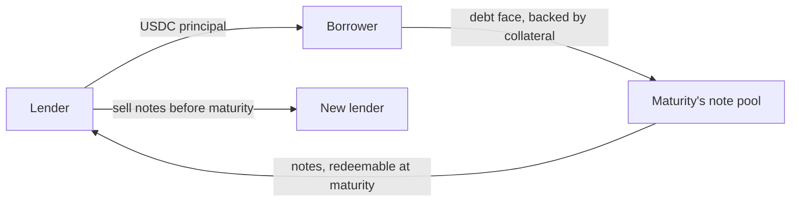

Setllend has one instrument: a **note**. A note is a claim to receive USDC at a fixed date, the [maturity](./maturities.md). It pays no interest along the way. Instead, a lender buys it today for less than it pays at maturity, and the difference is the interest. This is how a zero-coupon bond works, and it is why the rate is fixed: the amount due at maturity is set when the loan is made and never changes.

## Lending buys notes, borrowing issues them

Every trade on Setllend is somebody buying notes from somebody else.

| You want to | You place | What happens when it fills |
|---|---|---|
| Lend USDC at a fixed rate | a `lend` order (a bid) | You pay the **principal** in USDC and receive notes worth more USDC at maturity |
| Borrow USDC at a fixed rate | a `borrow` order (an ask) | You receive the principal in USDC and owe the **debt face** at maturity, backed by collateral |
| Get out of a loan you made before maturity | a `sell_note` order (an ask) | A new lender pays you USDC and takes over your notes. No new debt is created |



A borrower is, in effect, selling newly created notes: they take USDC today and promise to repay more at maturity. A lender who sells their notes early is selling existing ones. Both are asks on the same [order book](./order-book.md), so a single book per maturity serves new loans and the resale of old ones.

This design gives two things fixed-rate lending usually lacks:

- **Lenders are not locked in.** A lender can sell notes on the book at any time before maturity. See [Exit early](../guides/exit-early.md).
- **Borrowers can repay early**, either by paying the debt face or, more cheaply, by buying notes back on the book (see [Netting](#netting)).

## Worked example

A lender and a borrower meet at 8% APR on a book that matures in exactly 21 days. The borrower borrows 1,000 USDC.

- Note value the lender receives: 1,000 × (1 + 0.08 × 21 / 365) = **1,004.602739 USDC**, rounded down to the 6 decimals of USDC.
- Debt face the borrower owes: **1,004.602740 USDC**, the same number rounded up.
- The lender paid 1,000 USDC for a claim to 1,004.602739 USDC, a price of about **0.995418 USDC per 1 USDC of note value**.

At maturity the borrower repays 1,004.602740 USDC (or is [liquidated](./liquidation.mdx)), and the lender [redeems](../guides/redeem.md) 1,004.602739 USDC. The 0.000001 USDC difference stays in the contract (see [Rounding](#rounding-always-favors-the-pool)). How the APR turns into these numbers is on [Rates and prices](./rates-and-prices.mdx).

## Notes are positions, not tokens

Notes live inside the Setllend contract (`setllend.near`), one balance per account and maturity. They are not tokens on the `intents.near` ledger, so they don't appear in a wallet and can't be sent to another account. The only way a note changes hands is a `sell_note` fill on the book. You can read any account's notes with the `get_notes` view, and the app shows them on the Portfolio page.

## Shares and value

Inside the contract, a note balance is a number of **note shares** in that maturity's note pool. Each maturity keeps two totals:

- `V`: the total note value, the USDC owed to all note holders together at maturity.
- `S`: the total number of shares.

The value of a balance is its share of the total:

```
value(shares)     = shares × V / S
shares_for(value) = value × S / V        (1 share = 1 unit of USDC while the pool is empty)
```

Without losses, `V / S` stays at about 1, so one share is worth about 1 USDC at maturity and the app can show shares as USDC. The reason for shares is **fair loss sharing**. If a borrower defaults and their collateral doesn't cover the debt, the shortfall is subtracted from `V` once, and `S` stays the same. Every share in that maturity loses the same fraction of its value at that moment, with no list of holders to walk through. A lender who joins after the loss buys shares at the new, lower `V / S`, so they pay for what the notes are now worth and don't absorb a loss that happened before they arrived. This is the method Morpho Blue uses for its supply shares. See [Bad debt](./bad-debt.md) for the full mechanism and an example.

| Operation | Effect on `V` and `S` | Rounding of shares |
|---|---|---|
| New notes from a `lend` × `borrow` fill (value `f`) | `S += shares_for(f)`, `V += f` | minted rounded down |
| Note sale (value `f`) | shares move from seller to buyer, `V` and `S` unchanged | moved rounded down |
| [Netting](#netting) (value `n`) | `S −= shares_for(n)`, `V −= n` | burned rounded up |
| Redeem (value `f`) | `S −= shares_for(f)`, `V −= f` | burned rounded up |
| Bad debt `B` realized | `V = max(V − B, 0)`, `S` unchanged | – |

### Free and locked shares

Each balance is split into **free** and **locked** shares. Placing a `sell_note` order locks the shares it offers, so they can't be sold twice. Redeeming and netting use free shares only. To redeem notes that sit in an unfilled sell order, cancel the order first, which unlocks them.

## Rounding always favors the pool

Every rounding in the note math goes against the account that acts, so the holders who remain are never diluted:

- A borrower's debt face rounds **up**, a lender's note value rounds **down**.
- Shares minted or bought round **down**, shares burned when you redeem or net round **up**.
- When the last shares of a maturity are burned, `V` is reset to 0. Any value left over from rounding has no holder, and the USDC behind it stays in the maturity's redemption pool.

Each rounding moves at most one smallest unit (0.000001 USDC). The result is a simple invariant the contract keeps for every maturity: the USDC in the redemption pool plus all outstanding debt face is at least the total note value `V`.

A fill whose note value would convert to zero shares is rejected (`zero_shares`), so a lender never pays USDC for nothing.

## Netting

If one account holds both notes and debt in the same maturity, the two cancel out automatically. After every fill, and after a `sell_note` cancel, the contract takes `n = min(value of free notes, debt face)`, burns that much note value, and reduces the debt by the same amount. This is safe for everyone else: the same value leaves both the debt and `V`, so the redemption pool is untouched.

Netting is how a borrower repays early at a discount. Paying the debt with a `repay` before maturity costs the full debt face. Buying notes back with a `lend` order in the same maturity costs less, because notes trade below their value until maturity.

**Example.** The borrower above owes 1,004.602740 USDC. Ten days before maturity, notes trade at 8% APR. The borrower places a `lend` order that buys 500 USDC of note value for 500 / (1 + 0.08 × 10 / 365) ≈ **498.91 USDC**. As soon as it fills, the 500 of notes net against the debt, which drops to 504.602740 USDC. Repaying the same 500 of debt directly would have cost 500 USDC.

## At maturity

From the maturity time on, note holders redeem their free notes for USDC from the maturity's **redemption pool**, which fills with repayments and with the USDC liquidators pay. A redemption pays up to what the pool holds; any value the pool can't pay yet stays as shares until more repayments or liquidations arrive. See [Maturities](./maturities.md) for the full timeline and [Redeem](../guides/redeem.md) for the steps in the app.
