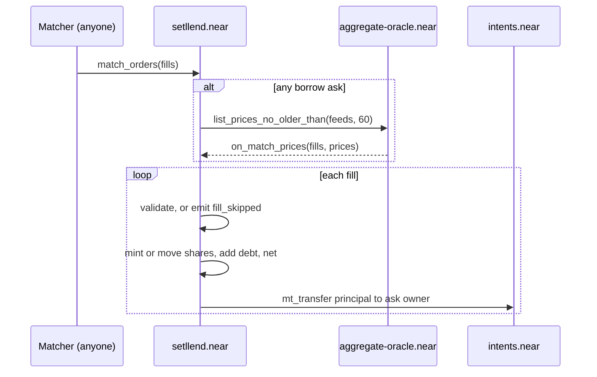

Orders rest in the contract's books until someone calls `match_orders` with a list of fills. Setllend's matcher does this for every crossing pair it finds, but the method is **permissionless**: anyone may call it, and the contract checks every fill itself. The matcher picks pairs and sizes. It never picks the rate.

## Signature

```rust
pub fn match_orders(&mut self, fills: Vec<Fill>) -> PromiseOrValue<()>

pub struct Fill {
    pub bid: U64,        // order_id of a lend order
    pub ask: U64,        // order_id of a borrow or sell_note order
    pub principal: U128, // USDC the bid pays
}
```

Arguments as JSON:

```json
{"fills":[{"bid":"7","ask":"3","principal":"1000000000"},{"bid":"8","ask":"5","principal":"217"}]}
```

It is a plain function call to `setllend.near` with no deposit. Setllend's matcher sends it from `backend.setllend.near` with 300 Tgas attached. An empty `fills` list panics with `No fills`.

A batch may mix `borrow` and `sell_note` asks, span several maturities, and fill the same order more than once. Each fill is checked against the state left by the fills before it.

## The rules

- **Crossing.** A bid and an ask cross when `bid.min_rate_bps ≤ ask.max_rate_bps`.
- **Fill rate = the maker's limit rate.** The maker is the older order, the one with the lower `order_id` (IDs are sequential). If the bid is older, the fill happens at the bid's `min_rate_bps`, otherwise at the ask's `max_rate_bps`. Both are within both limits, since the orders cross.
- **Sizes are principal.** `principal` is the USDC the bid pays, whatever the ask kind. It must be greater than zero and at most the bid's remaining principal. For a `borrow` ask it must be at most the ask's remaining principal. For a `sell_note` ask, the contract converts it to note value and then to shares, and the shares must be at most the ask's remaining shares.
- **Time.** Both orders must be unexpired (`block_time < expires_at`), and the maturity must still be in the future: `dt = maturity − block_time > 0`.
- **No self-trade.** The bid and the ask must have different owners.
- **Live notes.** The maturity's note pool must still be priceable: `V > 0`, or `S = 0`. If bad debt ever wiped out a maturity completely, it accepts no more fills.

The face of a fill is the principal grown at simple interest on a 365-day year:

```
face = principal × (10^4 × YEAR_NS + rate_bps × dt) / (10^4 × YEAR_NS)
```

See [Math](./math.md#face) for rounding and a worked example.

## `lend` × `borrow`: new notes and debt

A fill between a `lend` bid and a `borrow` ask creates a new loan position.

1. The lender gets new note shares worth `face` rounded **down**: `shares_for(face)` shares, rounded down, are minted, and the maturity's `V` and `S` grow.
2. The borrower's loan in that maturity gets `face` rounded **up** as new debt. The one-unit difference stays with note holders.
3. Escrow moves pro rata from the order into the loan: `escrow_left_i × principal / remaining_principal` per token, rounded down. The fill that completes the order moves all that is left. A `borrow` against the loan has no escrow and moves nothing.
4. **The loan as a whole must pass the max LTV check after the fill**, at conservative oracle prices:

   ```
   Σ (non-frozen tokens) amount_i × (price_i − conf_i) × max_ltv_i  ≥  debt_face × (usdc_price + usdc_conf)
   ```

   This includes collateral and debt the loan already had. Frozen tokens give no borrowing power.
5. The bid's USDC (`principal`) is paid from Setllend's Intents balance to the borrower's Intents balance with `mt_transfer`.
6. Both accounts are netted (below).

Any fill with a `borrow` ask needs prices, so a batch that has one makes **one oracle call for the whole batch** (the USDC feed and every collateral feed) and settles everything in the private callback `on_match_prices`.

## `lend` × `sell_note`: notes change hands

A fill between a `lend` bid and a `sell_note` ask moves existing notes. No new notes or debt are created, and `V` and `S` stay the same.

1. `face` is computed at the fill rate, rounded down.
2. `shares_for(face)`, rounded down, move from the seller's locked shares to the buyer's free shares.
3. The bid's `principal` is paid to the seller's Intents balance.
4. Both accounts are netted.

The `sell_note` ask's `remaining` counts shares, and the `order_filled` event's `ask_remaining` does too. Because principal is converted to value and then to shares with rounding down twice, some share counts can't be hit exactly. Example at 8% APR with 21 days left and `V / S = 1`: a principal of 217 buys 217 shares and 218 buys 219, so a fill of exactly 218 shares doesn't exist. A matcher should size each `sell_note` fill as the largest principal whose shares stay within `remaining`. A leftover of about one unit can stay locked until the seller cancels.

A batch of only `sell_note` fills needs no prices and settles synchronously in `match_orders` itself.

## Netting

After every fill, the contract nets the buyer and the seller: if an account holds free note shares and debt in the same maturity, they cancel.

```
n = min(value(free_shares), debt_face)
debt_face −= n
V −= n,  S −= shares_for(n)   (rounded up; all free shares if n is their whole value)
```

`n` leaves both the debt and the note pool, so the redemption pool is unaffected. This is how a borrower repays early at the market price: buy notes back with a `lend` order, and the fill nets them against the debt. A `netted` event is emitted when `n > 0`.

## Execution and failure

**One bad fill does not revert the batch.** Every fill is validated when it executes, in the synchronous path and again in the callback, since orders can be filled or cancelled while the oracle call is in flight. A fill that fails a check is skipped with a `fill_skipped` event naming the reason, changes no state, and the rest of the batch goes on. Checks only read state, so a skipped fill leaves no trace but the event.

**Oracle trouble.** In the callback, a `borrow` fill without usable prices (the oracle call failed, a feed came back `null`, or a price failed validation) is skipped with `no_price`. `sell_note` fills in the same batch still settle, since they need no price. Price validation rules are in [Math](./math.md#price-validation).

**When the whole call fails.** Some failures do revert everything: an oracle response that doesn't parse as the oracle's JSON panics the callback, and a fill whose math overflows panics with `Math overflow`. Running out of prepaid gas fails the call too. In each case no fill of the batch executes. The matcher can resubmit a smaller batch, or the `sell_note` fills alone.

**Payouts are detached.** Each fill pays the ask owner with its own `mt_transfer` promise. A payout that fails is credited to the recipient's free balance by `on_payout` (event `payout_failed`) and doesn't undo the fill.

**Batch limits.** The contract sets no maximum number of fills. The 300 Tgas transaction limit does: each payout reserves 15 Tgas of static gas, so prepaid gas, not burnt gas, decides how many fills fit. Setllend's matcher sends at most 10 fills per call and halves that after a failed call. Measured numbers are in [Gas](./gas.md#match_orders).



## Skip reasons

`fill_skipped` reasons, in the order they are checked:

| Reason | Meaning |
|---|---|
| `bid_not_found` / `ask_not_found` | The order doesn't exist (filled, cancelled, or never placed) |
| `bid_not_lend` | The bid isn't a `lend` order |
| `ask_is_lend` | The ask is a `lend` order |
| `maturity_mismatch` | The orders are in different maturities |
| `self_trade` | Same owner on both sides |
| `bid_expired` / `ask_expired` | `block_time ≥ expires_at` |
| `not_crossed` | `bid.min_rate_bps > ask.max_rate_bps` |
| `matured` | `dt ≤ 0`: the maturity has passed |
| `zero_principal` | `principal = 0` |
| `bid_oversize` | `principal` above the bid's remaining principal |
| `notes_wiped_out` | The maturity's `V = 0` while `S > 0` |
| `ask_oversize` | Above the ask's remaining principal (`borrow`) or remaining shares after conversion (`sell_note`) |
| `zero_shares` | The fill's note value converts to 0 shares |
| `no_price` | `borrow` ask only: no usable price for USDC or for a token of the loan that counts toward the max LTV check |
| `cannot_open` | `borrow` ask only: the loan fails the max LTV check after the fill |

## Events of a fill

In order: `order_filled` (with `rate_bps`, `principal`, `face`, and the remaining sizes of both orders), then `netted` for the buyer and the seller when it applies. A payout that fails adds `payout_failed` in a later receipt. See [Events](./events.md).

`order_filled.face` is the note value bought before conversion to shares. While `V / S = 1` the shares equal it. After bad debt, the shares can be worth up to one unit less; `get_notes` has the exact value. For a `borrow` ask, the debt added is `face` or one unit more.
