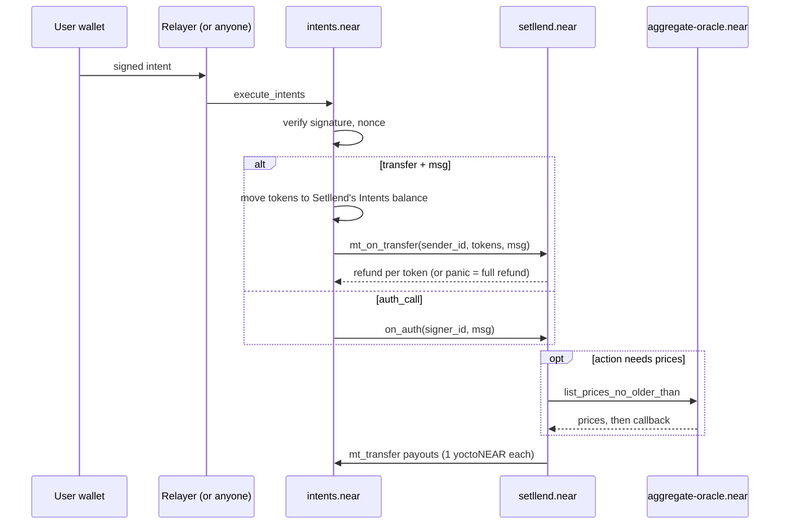

Setllend's on-chain logic is a single Rust smart contract deployed at [`setllend.near`](https://nearblocks.io/address/setllend.near) on NEAR mainnet. It holds the order books, escrow, loans, and notes for every maturity, matches nothing on its own, and moves funds only inside the user's Intents balance on `intents.near`. This section is the full reference for developers and auditors: every entry point, message, view, event, and error string, copied from the deployed code.

The deployed code is commit [`49fcc47`](https://github.com/TarasBrilian/setllend/tree/49fcc47e0167b7a7b4958078a3fedb07354bbd90) of the repository, built reproducibly. The contract's `contract_source_metadata` view names that commit and the build image, so anyone can rebuild it and compare the code hash. See [Verify the contract](../../verify/verify-contract.md).

## What the contract does

- **Keeps one order book per maturity.** A `lend` order is a bid that escrows USDC. A `borrow` order is an ask that escrows collateral (or borrows against collateral already in a loan) and issues new notes. A `sell_note` order is an ask that locks existing notes for sale. See [Order book](../../concepts/order-book.md).
- **Checks and settles fills.** Anyone may call `match_orders` with pairs of orders and sizes. The contract validates each fill, sets the rate (the maker's limit rate), mints notes and debt or moves notes, and pays the USDC out. See [Matching](./matching.md).
- **Holds loans.** One loan per (borrower, maturity), holding one or more collateral tokens and a debt face. It supports adding collateral, repaying, withdrawing collateral, and liquidation with pro rata seizure.
- **Accounts for notes as shares** of a per-maturity pool, so bad debt is shared fairly by all note holders of that maturity. See [Math](./math.md).
- **Reads prices** from `aggregate-oracle.near` when an action needs them (borrow fills, liquidation, collateral withdrawal with debt) and validates them itself.
- **Pays out** to the user's Intents balance with `mt_transfer` on `intents.near`. A payout that fails is credited to an internal free balance the user can withdraw later.

## What it does not do

- **It never verifies signatures.** Users sign intents. `intents.near` verifies the signature, executes the intent, and then calls Setllend. Setllend trusts exactly one caller for user actions: it checks `predecessor_account_id == intents.near` in `mt_on_transfer` and `on_auth`, and rejects any other caller with `Caller must be the intents contract`.
- **It holds no tokens outside NEAR Intents.** Escrow sits in `setllend.near`'s own Intents balance. Deposits from other chains and exits to them happen outside the contract (1Click or the bridges).
- **It does not match orders by itself.** A matcher (Setllend runs one, anyone may run another) proposes fills. The contract only accepts or skips them.
- **It does not swap.** A liquidator repays USDC and receives collateral. There is no DEX call inside the contract.
- **It has no pause and no user limits.** No minimum or maximum order size, no deposit caps, no order-count limits, no rate range.
- **Views make no cross-contract calls,** so the contract does not return a health factor. Clients compute it off-chain with the same formula and fresh oracle prices.

## Entry points

| Entry point | Called by | Purpose | Page |
|---|---|---|---|
| `mt_on_transfer(sender_id, previous_owner_ids, token_ids, amounts, msg)` | `intents.near` only, after a `transfer` intent with `msg` | Actions that bring tokens in: `lend`, `borrow`, `add_collateral`, `repay`, `liquidate` | [Transfer messages](./messages.md) |
| `on_auth(signer_id, msg)` | `intents.near` only, after an `auth_call` intent | Actions without incoming tokens: `borrow` against a loan, `cancel`, `sell_note`, `withdraw_collateral`, `redeem`, `withdraw` | [Auth call actions](./auth-call.md) |
| `match_orders(fills)` | Anyone | Settle a batch of fills | [Matching](./matching.md) |
| `add_maturity`, `add_collateral_token`, `update_collateral_token`, `freeze_collateral_token`, `unfreeze_collateral_token` | The owner only | Maturities and collateral tokens | [Owner methods](./owner.md) |
| `get_*` views | Anyone, free | Read state | [Views](./views.md) |
| `on_payout`, `on_match_prices`, `on_liquidate_prices`, `on_withdraw_collateral_prices` | The contract itself only (`#[private]`) | Callbacks of payouts and oracle calls | [Gas](./gas.md) |
| `new(config)` | The contract account only (`#[private]`), once at deploy | Initialization | [Owner methods](./owner.md) |

The owner is `setllend.near` itself (`owner_id` in `get_config`). The contract emits a log line for every state change, described in [Events](./events.md).

## How a call reaches the contract

A user never calls `setllend.near` directly. They sign an intent with their wallet (ERC-191 for EVM wallets, NEP-413 for NEAR wallets, see [Signing intents](../signing-intents.mdx)). Someone submits it to `intents.near` with `execute_intents`: Setllend's relayer does this and pays the gas, but anyone holding the signed payload can. `intents.near` checks the signature and nonce, runs the intent, and calls Setllend.



Two properties matter for integrators:

- **A `transfer` is atomic with the action.** If `mt_on_transfer` panics, Setllend's state is reverted and `intents.near` refunds the full amount to the sender's Intents balance. A partial refund (for example the overpayment of a `repay`) comes back through the return value.
- **An `auth_call` is detached.** The intent batch succeeds even if `on_auth` fails. To know whether the action happened, read the outcome of the `on_auth` receipt, and for actions that pay out, look for a `payout_failed` event too. See [Auth call actions](./auth-call.md).

## Units and encoding

| Field | Rust type | JSON | Notes |
|---|---|---|---|
| Amounts | `u128` | decimal string, e.g. `"1000000000"` | Smallest unit of the token. USDC has 6 decimals, ETH 18, NEAR 24. `"1000000000"` is 1,000 USDC |
| Gas | `u64` | decimal string of gas units | `"100000000000000"` is 100 Tgas |
| Rates | `u32` | number, e.g. `700` | APR in basis points (bps). `700` = 7.00%. Any value is accepted |
| Ratios | `u32` | number | `max_ltv`, `liq_threshold`, `liq_bonus` in bps, per collateral token. `7000` = 70% |
| Timestamps | `u64` | decimal string | Nanoseconds since the Unix epoch, like `env::block_timestamp()`. `expires_at` and `created_at` use it |
| `maturity` | `u64` | decimal string | A timestamp from the maturity list, e.g. `"1795766400000000000"` = 2026-11-27 08:00 UTC |
| `order_id` | `u64` | decimal string | Sequential from `"0"`, never reused |
| Note shares | `u128` | decimal string | Internal unit of note ownership in one maturity. Values are shown next to shares in views |
| Oracle durations | `u32` | number | `oracle_max_age` in seconds. `grace` is a `u64` decimal string in nanoseconds (`"3600000000000"` = 1 hour) |
| Token IDs | `String` | string | NEAR Intents asset ID, e.g. `nep141:arb.omft.near`. See [Asset IDs](../asset-ids.md) |
| Accounts | `AccountId` | string | An EVM wallet is the implicit account of its address in **lowercase**, e.g. `0x2222222222222222222222222222222222222222`. A NEAR wallet is its NEAR account, e.g. `alice.near`. The contract treats both alike |

:::warning
NEAR account IDs are lowercase. A checksummed (mixed-case) EVM address is not a valid account ID: in a `msg` field such as `borrower` it fails to parse and the whole action is rejected with `Invalid msg`. Lowercase the address first.
:::

Numbers that can exceed 2^53 (`u64`, `u128`) are always strings; small integers (`u32`, `u8`) are plain JSON numbers. A `u64` or `u128` field written as a JSON number fails to parse.

### Assets on mainnet

| Role | Asset ID | Decimals |
|---|---|---|
| Debt token (USDC, native on NEAR) | `nep141:17208628f84f5d6ad33f0da3bbbeb27ffcb398eac501a31bd6ad2011e36133a1` | 6 |
| Collateral: ETH from Arbitrum | `nep141:arb.omft.near` | 18 |
| Collateral: ETH from Base | `nep141:base.omft.near` | 18 |
| Collateral: NEAR (wrapped) | `nep141:wrap.near` | 24 |

`get_config` and `get_collateral_tokens` return the live list. Examples on these pages use the debt token's full asset ID or shorten it only where noted.

## The `msg` format

Both `mt_on_transfer` and `on_auth` take a `msg` string. It is a JSON object **serialized into a string**, tagged by action:

```json
{"action": "<snake_case action name>", "data": { ...fields of that action... }}
```

In Rust this is `#[serde(tag = "action", content = "data", rename_all = "snake_case")]`, the same tagging as the official `escrow-swap` contract. Because `msg` is itself a string inside the intent JSON, its quotes are escaped there:

```json
{
  "intent": "transfer",
  "receiver_id": "setllend.near",
  "tokens": {"nep141:17208628f84f5d6ad33f0da3bbbeb27ffcb398eac501a31bd6ad2011e36133a1": "1000000000"},
  "msg": "{\"action\":\"lend\",\"data\":{\"maturity\":\"1795766400000000000\",\"min_rate_bps\":700,\"expires_at\":null}}"
}
```

Optional fields (`expires_at`, `borrower`, the `value` of `redeem`, the `amount` of `withdraw`) may be `null` or left out. Unknown actions, missing required fields, and wrong types all fail with `Invalid msg`.

| Entry point | Actions |
|---|---|
| `mt_on_transfer` | `lend`, `borrow`, `add_collateral`, `repay`, `liquidate` |
| `on_auth` | `borrow`, `cancel`, `sell_note`, `withdraw_collateral`, `redeem`, `withdraw` |

`borrow` exists on both: as a transfer it escrows new collateral, as an auth call it borrows against collateral the loan already holds.

## Storage and fees

Users never attach NEAR to Setllend. The contract pays the storage of orders, loans, notes, and free balances from its own NEAR balance, and frees it when an entry closes. Setllend charges no fee of its own. See [Gas and storage](./gas.md).
