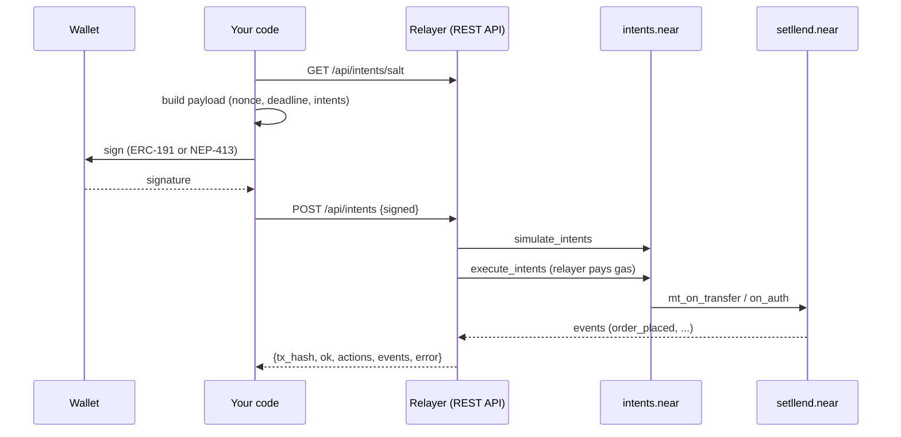

import Tabs from '@theme/Tabs';
import TabItem from '@theme/TabItem';

Every user action in Setllend is a **signed intent**: a small JSON message that the user signs with their wallet and that `intents.near` (the NEAR Intents verifier and ledger) executes. The user never sends a NEAR transaction for an order, a cancel, a repayment, or a withdrawal. Someone else submits the signed message and pays the gas: normally Setllend's **relayer**, but any NEAR account can do it.

This page explains the payload format, the intents Setllend understands, how to sign with an EVM wallet or a NEAR account, and how to submit and check the result. It ends with complete TypeScript examples that build a `lend` order and a `cancel`.

## How it fits together



## The payload

A payload is one JSON object. For an EVM account it is signed exactly as the string you build; for a NEAR account the same fields are split across the NEP-413 message (see [below](#sign-with-a-near-account-nep-413)).

| Field | Type | Value |
|---|---|---|
| `signer_id` | string | The signer's Intents account: the **lowercase** `0x…` address of an EVM wallet, or a NEAR account such as `alice.near` |
| `verifying_contract` | string | Always `intents.near` |
| `deadline` | string | RFC 3339 time after which the payload is invalid, for example `2026-11-06T12:10:00.000Z` (`Date.toISOString()` works). It must not be later than the deadline inside the nonce |
| `nonce` | string | Base64 of a 32-byte **versioned nonce** ([format below](#the-nonce)). Each nonce can be used once |
| `intents` | array | One or more intents, executed in order |

A complete payload for a `lend` order of 100 USDC at a minimum of 7.00% APR in the 2026-11-27 maturity:

```json
{
  "signer_id": "0x1234567890abcdef1234567890abcdef12345678",
  "verifying_contract": "intents.near",
  "deadline": "2026-11-06T12:10:00.000Z",
  "nonce": "Vij2xgAlKBKzAPDFTXtz5RgHBwcHBwcHBwcHBwcHBwc=",
  "intents": [
    {
      "intent": "transfer",
      "receiver_id": "setllend.near",
      "tokens": {
        "nep141:17208628f84f5d6ad33f0da3bbbeb27ffcb398eac501a31bd6ad2011e36133a1": "100000000"
      },
      "msg": "{\"action\":\"lend\",\"data\":{\"maturity\":\"1795766400000000000\",\"min_rate_bps\":700,\"expires_at\":null}}"
    }
  ]
}
```

All amounts are decimal strings in the token's smallest unit (USDC has 6 decimals, so `"100000000"` is 100 USDC), and every timestamp, including `maturity`, is a decimal string of nanoseconds. Asset IDs and decimals are listed in [Asset IDs](./asset-ids.md).

:::danger Sign the exact bytes you submit
The signature covers the payload string byte for byte. Build the JSON once, sign that string, and submit that same string. Never parse and re-serialize it between signing and submitting: a changed key order or whitespace makes the signature invalid.
:::

## Intents Setllend uses

### `transfer`: move tokens into Setllend with an action

A `transfer` moves tokens from the signer's Intents balance to `setllend.near` and delivers a `msg` to the contract (`mt_on_transfer`). This is how orders that need funds are placed, atomically with the deposit.

| Field | Value |
|---|---|
| `intent` | `"transfer"` |
| `receiver_id` | `"setllend.near"` |
| `tokens` | `{ "<asset id>": "<amount>" }` |
| `msg` | The action, as a JSON **string** (see below) |
| `min_gas` | Optional decimal string of gas units. Required for `liquidate` (at least `"100000000000000"`, 100 Tgas). Others may leave it out (30 Tgas default) but must not set it lower |

The `msg` actions of a `transfer` and the tokens each one takes:

| `msg` action | Tokens | `data` |
|---|---|---|
| `lend` | Exactly one: USDC (the debt token) | `{"maturity", "min_rate_bps", "expires_at"}` |
| `borrow` | One or more collateral tokens, not frozen | `{"maturity", "max_rate_bps", "principal", "expires_at"}` |
| `add_collateral` | One or more collateral tokens, not frozen | `{"maturity"}` |
| `repay` | Exactly one: USDC | `{"maturity", "borrower"}` (`borrower: null` means yourself) |
| `liquidate` | Exactly one: USDC | `{"borrower", "maturity"}` |

If the contract rejects a `transfer` (an unknown maturity, a past `expires_at`, wrong tokens), the whole amount goes back to the signer's Intents balance.

### `auth_call`: an action without moving tokens

An `auth_call` asks `intents.near` to call `on_auth` on `setllend.near` with the signer as the authenticated caller. It is used for every action that needs no new funds.

| Field | Value |
|---|---|
| `intent` | `"auth_call"` |
| `contract_id` | `"setllend.near"` |
| `msg` | The action, as a JSON **string** |
| `min_gas` | **Required:** at least `"100000000000000"` (100 Tgas) |
| `attached_deposit` | Leave it out (or `"0"`). A deposit would be taken from the signer's wNEAR and is not refunded if the call fails |

| `msg` action | `data` |
|---|---|
| `borrow` | `{"maturity", "max_rate_bps", "principal", "expires_at"}`: borrow against collateral the loan already holds |
| `cancel` | `{"order_id"}` |
| `sell_note` | `{"maturity", "value", "max_rate_bps", "expires_at"}` |
| `withdraw_collateral` | `{"maturity", "collateral_token", "amount"}` |
| `redeem` | `{"maturity", "value"}` (`value: null` means all free notes) |
| `withdraw` | `{"token_id", "amount"}` (`amount: null` means the whole free balance) |

:::warning Always set `min_gas` on an `auth_call`
`intents.near` guarantees `on_auth` only its `min_gas`, which defaults to 10 Tgas. That is not enough for a payout (15 Tgas each) or an oracle round trip (about 30 Tgas). Too little gas makes the action fail before it changes anything: no funds are lost, but nothing happens. The relayer refuses an `auth_call` without at least 100 Tgas (`min_gas_too_low`).
:::

The `msg` is always `{"action": "<name>", "data": {...}}`, serialized into a string. Rates are plain numbers in basis points (`700` = 7.00% APR); amounts, timestamps, and order IDs are decimal strings; `null` fills an optional field. The full field reference, with every rule the contract checks, is in [Messages](./contract/messages.md) and [auth_call actions](./contract/auth-call.md).

```json
{"action":"cancel","data":{"order_id":"42"}}
```

### `ft_withdraw` and `native_withdraw`: out to your own NEAR account \{#withdrawals-to-your-own-near-account\}

A NEAR account can take USDC or NEAR out of its Intents balance to itself with one signed intent. The relayer accepts these only when the payload holds **exactly one** of them and nothing else, the `receiver_id` is the signer itself, and the signer is a NEAR account (an EVM account leaves through 1Click instead).

| Intent | Fields (no others) | Notes |
|---|---|---|
| `ft_withdraw` | `intent`, `token`, `receiver_id`, `amount` | `token` is the USDC contract **without** the `nep141:` prefix: `17208628f84f5d6ad33f0da3bbbeb27ffcb398eac501a31bd6ad2011e36133a1` |
| `native_withdraw` | `intent`, `receiver_id`, `amount` | `amount` in yoctoNEAR, taken from the signer's wNEAR (`nep141:wrap.near`) and delivered as native NEAR |

```json
{"intent":"ft_withdraw","token":"17208628f84f5d6ad33f0da3bbbeb27ffcb398eac501a31bd6ad2011e36133a1","receiver_id":"alice.near","amount":"5000000"}
```

```json
{"intent":"native_withdraw","receiver_id":"alice.near","amount":"1000000000000000000000000"}
```

Before relaying, the relayer checks that the withdrawal can succeed: for `ft_withdraw` the receiver must already have storage on the USDC contract (register it with `storage_deposit`, 0.00125 NEAR, or the answer is `storage_missing`); for `native_withdraw` a named receiver must exist (else `receiver_missing`), because NEAR sent to a missing account is lost. A withdrawal cannot share a payload with a Setllend intent: an `auth_call` such as `withdraw` frees funds only in a later receipt, after the withdrawal has already tried to take them.

### Several intents in one payload

A payload may hold several Setllend intents, for example a `cancel` followed by a new `lend`. They execute in order under one nonce. Keep in mind that a `cancel` returns its escrow only after the payload has run, so the new order needs funds of its own.

## The nonce

`intents.near` requires a **versioned nonce**: 32 bytes, base64-encoded.

| Bytes | Content |
|---|---|
| 0 to 3 | Magic `56 28 f6 c6` |
| 4 | Version `00` |
| 5 to 8 | The 4-byte **salt** of `intents.near` |
| 9 to 16 | The nonce's own deadline in nanoseconds since the Unix epoch, signed 64-bit little-endian |
| 17 to 31 | 15 random bytes |

The salt can rotate, so fetch it fresh: `GET /api/intents/salt` returns `{"salt": "252812b3"}` (the API caches the `current_salt` view of `intents.near` for 60 seconds), or call `current_salt` on `intents.near` yourself. Use the same time for the nonce's deadline and the payload's `deadline`. A nonce runs once: after a payload has been executed, or has been sent and may have been executed, sign a new one rather than resubmitting.

How long to make the deadline is up to you. The Setllend app uses 10 minutes, which leaves room for the wallet prompt and a first-time key registration.

## Sign with an EVM account (ERC-191)

An EVM wallet (MetaMask, Rabby, or any EOA wallet) signs the payload string with `personal_sign`, the ERC-191 "Ethereum Signed Message" scheme. No registration is needed: the wallet's address, lowercased, is already an Intents account.

1. Build the payload with `signer_id` set to the **lowercase** address. Wallets return checksummed addresses; a mixed-case `signer_id` is not a valid account ID.
2. Call `personal_sign` with the payload string as the message (in viem: `signMessage({ account, message: payload })`).
3. Convert the 65-byte `0x…` signature to `secp256k1:` plus base58 of `r ‖ s ‖ v`, with `v` normalized to `0` or `1`. Wallets return `v` as `27`/`28` or `0`/`1`; subtract 27 from the first.

The signed object:

```json
{
  "standard": "erc191",
  "payload": "{\"signer_id\":\"0x1234567890abcdef1234567890abcdef12345678\",\"verifying_contract\":\"intents.near\",...}",
  "signature": "secp256k1:<base58 of 65 bytes>"
}
```

`payload` is the exact signed string. There is no public key field: `intents.near` recovers the address from the signature.

## Sign with a NEAR account (NEP-413)

A NEAR account signs with NEP-413, the standard for off-chain message signing that NEAR wallets implement as `signMessage`. The payload fields are split: `message` holds the JSON `{"signer_id", "deadline", "intents"}` (no `verifying_contract` and no `nonce`), and the nonce and the verifying contract travel beside it.

| NEP-413 field | Value |
|---|---|
| `message` | The JSON string `{"signer_id":"alice.near","deadline":"…","intents":[…]}` |
| `recipient` | `intents.near` |
| `nonce` | The same 32-byte versioned nonce. A wallet takes the raw bytes; the signed object carries them base64-encoded |

The signed object:

```json
{
  "standard": "nep413",
  "payload": {
    "message": "{\"signer_id\":\"alice.near\",\"deadline\":\"2026-11-06T12:10:00.000Z\",\"intents\":[...]}",
    "nonce": "Vij2xgAlKBKzAPDFTXtz5RgHBwcHBwcHBwcHBwcHBwc=",
    "recipient": "intents.near"
  },
  "public_key": "ed25519:<base58>",
  "signature": "ed25519:<base58 of 64 bytes>"
}
```

Wallets return the signature in base64; re-encode it as base58 and prefix `ed25519:`.

:::warning NEAR Wallet Selector wants a `Buffer` nonce
`signMessage` in `@near-wallet-selector/core` throws "Invalid nonce. It must be a Buffer with a length of 32 bytes." when the nonce is a plain `Uint8Array`, before the wallet even sees the request. Pass `Buffer.from(nonceBytes)` (from the `buffer` package in the browser).
:::

If you sign with a raw ed25519 key instead of a wallet, sign the SHA-256 hash of these bytes: the tag `2^31 + 413` as a u32 little-endian, then the borsh encoding of `message` (u32 length + UTF-8 bytes), the 32 nonce bytes, `recipient` (u32 length + bytes), and a single `0` byte for the absent callback URL. The [NEAR key example](#complete-examples) below does exactly that.

### Register the key once

`intents.near` accepts a NEP-413 signature only from a key registered for the account. For a **named** account (such as `alice.near`), register the signing key once with a transaction from that account:

- Contract: `intents.near`
- Method: `add_public_key`
- Arguments: `{"public_key": "ed25519:<the key the wallet signed with>"}`
- Deposit: **exactly 1 yoctoNEAR**
- Gas: 30 Tgas is plenty

Check first with the view `has_public_key({"account_id": "alice.near", "public_key": "ed25519:…"})`, which returns `true` once the key is registered. An **implicit** NEAR account (64 hex characters) needs no registration: `has_public_key` is already `true` for its own key.

The Setllend app signs first, then checks `has_public_key` with the key the wallet returned, and asks for the registration transaction only if it is missing. This is the only NEAR transaction a NEAR user signs for intents, and it is needed once per key.

## Submit the signed payload

### Through the relayer: `POST /api/intents`

Send the signed object wrapped in `{"signed": …}`:

```bash
curl -s -X POST https://setllend-production.up.railway.app/api/intents \
  -H 'content-type: application/json' \
  -d '{"signed": {"standard": "erc191", "payload": "…", "signature": "secp256k1:…"}}'
```

The relayer pays the gas, so it relays only payloads made of Setllend intents (or one withdrawal to the signer's own NEAR account) with enough `min_gas`, and only known fields on each intent. It then runs `simulate_intents`, submits `execute_intents` with 300 Tgas, and reads every receipt to tell you whether the action really happened. The answer is always the same shape:

```json
{
  "tx_hash": "<NEAR transaction hash>",
  "ok": true,
  "actions": ["lend"],
  "events": [
    {
      "event": "order_placed",
      "data": {
        "order_id": "7",
        "owner": "0x1234567890abcdef1234567890abcdef12345678",
        "kind": "lend",
        "maturity": "1795766400000000000",
        "rate_bps": 700,
        "size": "100000000",
        "collateral": null,
        "expires_at": null
      }
    }
  ],
  "error": null
}
```

A payload that fails simulation costs no gas and comes back with HTTP 400, for example from an account without USDC on the Intents ledger:

```json
{
  "tx_hash": null,
  "ok": false,
  "actions": ["lend"],
  "events": [],
  "error": { "code": "simulation_failed", "reason": "insufficient balance or overflow" }
}
```

Every error code, its HTTP status, and what to do about it is in [REST API: POST /api/intents](./rest-api.md#post-apiintents). Two outcomes need care:

- **`202` with `error.code: "pending"`:** the transaction was sent but not every receipt finished within 30 seconds. `tx_hash` is set. The final answer arrives on the WebSocket topic `account:<signer_id>` as a message of `type: "intent"` ([WebSocket API](./websocket-api.md#intent)). Do not sign again until you know the outcome: the first payload may still execute.
- **`200` with `ok: false`, `error.code: "rejected"`:** the transaction ran but Setllend refused the action, with the contract's message as `reason` (for example `Order not found`). Funds sent with a `transfer` were refunded in full.

### Directly: `execute_intents` from your own NEAR account

Nothing requires the relayer. Any NEAR account can submit any signed payload by calling `execute_intents` on `intents.near` with the argument `{"signed": [<signed object>, ...]}`, 300 Tgas, and no deposit. `intents.near` checks the signatures, so the submitter needs no permission from the signer; it only pays the gas.

When you submit directly, the relayer's checks do not protect you:

- Set `min_gas` yourself on every `auth_call` and `liquidate` transfer.
- `auth_call` is **detached**: the `execute_intents` transaction succeeds even if `on_auth` fails. Read the receipts of `setllend.near` in the outcome (their status and their `EVENT_JSON:` logs) to know whether the action happened. See [Events](./contract/events.md).
- A `transfer` can also succeed as a transaction while `mt_on_transfer` panics and refunds the tokens. Again, check the Setllend receipt.

### Check first: `simulate_intents`

`simulate_intents` on `intents.near` takes the same argument as `execute_intents` and is a free view call. It verifies signatures, the nonce, the deadline, and balances, and returns `{"intents_executed", "logs", "min_deadline", "state"}` when the payload would run. A failure comes back as an RPC result whose `error` text ends in `GuestPanic { panic_msg: "<message>" }`, for example `invalid signature` or `insufficient balance or overflow`.

Simulation does not run Setllend's own logic (`mt_on_transfer` and `on_auth` run later, in their own receipts), so a payload can pass simulation and still be refused by the contract. Use the finality `optimistic` so a deposit from the last few seconds counts.

```bash
ARGS=$(printf '%s' '{"signed":[{"standard":"erc191","payload":"…","signature":"secp256k1:…"}]}' | base64 | tr -d '\n')
curl -s https://rpc.mainnet.fastnear.com -H 'content-type: application/json' -d '{
  "jsonrpc": "2.0", "id": 1, "method": "query",
  "params": { "request_type": "call_function", "finality": "optimistic",
    "account_id": "intents.near", "method_name": "simulate_intents", "args_base64": "'"$ARGS"'" }
}'
```

## Complete examples

The helpers below have no dependency on Setllend code. They need `@scure/base` for base58 and base64, plus `viem` for the EVM example, `@near-wallet-selector/core` and `buffer` for the NEAR wallet example, or `near-api-js` for the NEAR key example. The Setllend repository's `backend/src/shared/intents.ts` contains the same builders, used by the app and the backend.

```ts title="setllend-intents.ts"
import { base58, base64 } from "@scure/base";

export const API = "https://setllend-production.up.railway.app";
export const USDC = "nep141:17208628f84f5d6ad33f0da3bbbeb27ffcb398eac501a31bd6ad2011e36133a1";
const TGAS = 10n ** 12n;

/** The 4-byte salt of intents.near, as lowercase hex. Fetch it fresh: it can rotate. */
export async function getSalt(): Promise<string> {
  const res = await fetch(`${API}/api/intents/salt`);
  return ((await res.json()) as { salt: string }).salt;
}

/** 32-byte versioned nonce: magic, version 0, salt, deadline (ns, i64 LE), 15 random bytes. */
export function versionedNonce(salt: string, deadline: Date): Uint8Array {
  const bytes = new Uint8Array(32);
  bytes.set([0x56, 0x28, 0xf6, 0xc6], 0);
  bytes[4] = 0;
  for (let i = 0; i < 4; i++) bytes[5 + i] = parseInt(salt.slice(2 * i, 2 * i + 2), 16);
  new DataView(bytes.buffer).setBigInt64(9, BigInt(deadline.getTime()) * 1_000_000n, true);
  bytes.set(crypto.getRandomValues(new Uint8Array(15)), 17);
  return bytes;
}

/** A `lend` order: `amount` USDC (6 decimals) at `minRateBps` or better. */
export function lendIntent(amount: bigint, maturity: string, minRateBps: number) {
  return {
    intent: "transfer",
    receiver_id: "setllend.near",
    tokens: { [USDC]: amount.toString() },
    msg: JSON.stringify({ action: "lend", data: { maturity, min_rate_bps: minRateBps, expires_at: null } }),
  };
}

/** Cancels one of the signer's open orders. */
export function cancelIntent(orderId: string) {
  return {
    intent: "auth_call",
    contract_id: "setllend.near",
    msg: JSON.stringify({ action: "cancel", data: { order_id: orderId } }),
    min_gas: (100n * TGAS).toString(),
  };
}

/** `0x` + 65 bytes from personal_sign → `secp256k1:` + base58, with v normalized to 0 or 1. */
export function erc191Signature(hex: `0x${string}`): string {
  const bytes = Uint8Array.from(hex.slice(2).match(/../g)!, (b) => parseInt(b, 16));
  if (bytes.length !== 65) throw new Error("expected a 65-byte signature");
  if (bytes[64] === 27 || bytes[64] === 28) bytes[64] -= 27;
  return `secp256k1:${base58.encode(bytes)}`;
}

/** SHA-256 of the NEP-413 signing bytes, for signing with a raw ed25519 key. */
export async function nep413Hash(message: string, nonce: Uint8Array, recipient: string): Promise<Uint8Array> {
  const enc = new TextEncoder();
  const m = enc.encode(message);
  const r = enc.encode(recipient);
  const bytes = new Uint8Array(4 + 4 + m.length + 32 + 4 + r.length + 1);
  const view = new DataView(bytes.buffer);
  view.setUint32(0, 2 ** 31 + 413, true);
  view.setUint32(4, m.length, true);
  bytes.set(m, 8);
  bytes.set(nonce, 8 + m.length);
  view.setUint32(8 + m.length + 32, r.length, true);
  bytes.set(r, 8 + m.length + 36);
  // The last byte stays 0: no callback URL.
  return new Uint8Array(await crypto.subtle.digest("SHA-256", bytes));
}

export type RelayBody = {
  tx_hash: string | null;
  ok: boolean;
  actions: string[];
  events: { event: string; data: Record<string, unknown> }[];
  error: { code: string; reason: string } | null;
};

/** POST /api/intents. */
export async function relay(signed: object): Promise<{ status: number; body: RelayBody }> {
  const res = await fetch(`${API}/api/intents`, {
    method: "POST",
    headers: { "content-type": "application/json" },
    body: JSON.stringify({ signed }),
  });
  return { status: res.status, body: (await res.json()) as RelayBody };
}

export { base58, base64 };
```

<Tabs groupId="signer">
<TabItem value="evm" label="EVM wallet (viem)" default>

```ts title="evm.ts"
import { createWalletClient, custom } from "viem";
import { mainnet } from "viem/chains";
import { getSalt, versionedNonce, lendIntent, cancelIntent, erc191Signature, relay, base64 } from "./setllend-intents";

const wallet = createWalletClient({ chain: mainnet, transport: custom((window as any).ethereum) });
const [address] = await wallet.requestAddresses();
// The Intents account is the lowercase address.
const signerId = address.toLowerCase();

async function signAndRelay(intents: object[]) {
  const deadline = new Date(Date.now() + 10 * 60_000);
  const payload = JSON.stringify({
    signer_id: signerId,
    verifying_contract: "intents.near",
    deadline: deadline.toISOString(),
    nonce: base64.encode(versionedNonce(await getSalt(), deadline)),
    intents,
  });
  // personal_sign of the exact payload string.
  const hex = await wallet.signMessage({ account: address, message: payload });
  return relay({ standard: "erc191", payload, signature: erc191Signature(hex) });
}

// Lend 100 USDC at 7.00% APR or better in the 2026-11-27 maturity.
const placed = await signAndRelay([lendIntent(100_000_000n, "1795766400000000000", 700)]);
if (!placed.body.ok) throw new Error(placed.body.error?.reason);
const orderId = placed.body.events.find((e) => e.event === "order_placed")!.data.order_id as string;

// Cancel it: the remaining USDC returns to the Intents balance.
const cancelled = await signAndRelay([cancelIntent(orderId)]);
console.log(cancelled.status, cancelled.body);
```

</TabItem>
<TabItem value="near-wallet" label="NEAR wallet (Wallet Selector)">

```ts title="near-wallet.ts"
import { actionCreators, type WalletSelector } from "@near-wallet-selector/core";
import { Buffer } from "buffer";
import { getSalt, versionedNonce, lendIntent, cancelIntent, relay, base58, base64 } from "./setllend-intents";

const RPC = "https://rpc.mainnet.fastnear.com";

async function view<T>(accountId: string, method: string, args: object): Promise<T> {
  const res = await fetch(RPC, {
    method: "POST",
    headers: { "content-type": "application/json" },
    body: JSON.stringify({
      jsonrpc: "2.0", id: 1, method: "query",
      params: { request_type: "call_function", finality: "final", account_id: accountId, method_name: method,
        args_base64: base64.encode(new TextEncoder().encode(JSON.stringify(args))) },
    }),
  });
  const { result } = await res.json();
  return JSON.parse(new TextDecoder().decode(Uint8Array.from(result.result)));
}

// `selector` is your NEAR Wallet Selector instance, with a wallet signed in (Meteor, Intear, MyNearWallet, ...).
export async function signAndRelay(selector: WalletSelector, accountId: string, intents: object[]) {
  const wallet = await selector.wallet();
  const deadline = new Date(Date.now() + 10 * 60_000);
  const message = JSON.stringify({ signer_id: accountId, deadline: deadline.toISOString(), intents });
  const nonce = versionedNonce(await getSalt(), deadline);

  // Wallet Selector requires the nonce as a 32-byte Buffer.
  const signed = await wallet.signMessage!({ message, recipient: "intents.near", nonce: Buffer.from(nonce) });
  if (!signed || signed.accountId !== accountId) throw new Error("signed by another account");

  // First time only for a named account: register the key that signed.
  const known = await view<boolean>("intents.near", "has_public_key", { account_id: accountId, public_key: signed.publicKey });
  if (!known) {
    await wallet.signAndSendTransaction({
      receiverId: "intents.near",
      actions: [actionCreators.functionCall("add_public_key", { public_key: signed.publicKey }, 30n * 10n ** 12n, 1n)],
    });
  }

  return relay({
    standard: "nep413",
    payload: { message, nonce: base64.encode(nonce), recipient: "intents.near" },
    public_key: signed.publicKey,
    // The wallet returns base64; intents.near wants ed25519: + base58.
    signature: `ed25519:${base58.encode(base64.decode(signed.signature))}`,
  });
}

// Usage:
// const placed = await signAndRelay(selector, "alice.near", [lendIntent(100_000_000n, "1795766400000000000", 700)]);
// const orderId = placed.body.events.find((e) => e.event === "order_placed")!.data.order_id as string;
// await signAndRelay(selector, "alice.near", [cancelIntent(orderId)]);
```

</TabItem>
<TabItem value="near-key" label="NEAR key (near-api-js)">

```ts title="near-key.ts"
import { KeyPair, type KeyPairString } from "near-api-js";
import { getSalt, versionedNonce, nep413Hash, lendIntent, cancelIntent, relay, base58, base64 } from "./setllend-intents";

// A key registered on intents.near for `accountId` (or the account's own key, if it is implicit).
const key = KeyPair.fromString(process.env.NEAR_PRIVATE_KEY as KeyPairString);
const accountId = "alice.near";

async function signAndRelay(intents: object[]) {
  const deadline = new Date(Date.now() + 10 * 60_000);
  const message = JSON.stringify({ signer_id: accountId, deadline: deadline.toISOString(), intents });
  const nonce = versionedNonce(await getSalt(), deadline);
  const { signature } = key.sign(await nep413Hash(message, nonce, "intents.near"));
  return relay({
    standard: "nep413",
    payload: { message, nonce: base64.encode(nonce), recipient: "intents.near" },
    public_key: key.getPublicKey().toString(),
    signature: `ed25519:${base58.encode(signature)}`,
  });
}

const placed = await signAndRelay([lendIntent(100_000_000n, "1795766400000000000", 700)]);
console.log(placed.status, placed.body);
if (placed.body.ok) {
  const orderId = placed.body.events.find((e) => e.event === "order_placed")!.data.order_id as string;
  console.log(await signAndRelay([cancelIntent(orderId)]));
}
```

The implicit account of an ed25519 key is the hex of its 32 public-key bytes: `hex(base58.decode(publicKey.slice("ed25519:".length)))`. Such an account signs without any `add_public_key`.

</TabItem>
</Tabs>

Valid maturities come from `GET /api/maturities`; a maturity that is not listed, or already past, makes the contract refuse the order and refund the USDC.

## Checklist

- `signer_id` is lowercase; `verifying_contract` (ERC-191) or `recipient` (NEP-413) is `intents.near`.
- The salt is fresh, and the payload `deadline` equals the nonce's deadline and is in the future.
- `msg` is a string containing JSON, not a nested object.
- Amounts, timestamps, and order IDs are decimal strings; rates are numbers in bps.
- Every `auth_call` and every `liquidate` transfer has `min_gas` of at least `"100000000000000"`.
- No `attached_deposit` other than `"0"`, and no fields beyond the ones listed above.
- The submitted payload is the exact string (ERC-191) or `message` (NEP-413) that was signed.
- ERC-191 `v` is normalized to 0 or 1; NEP-413 signatures and keys are `ed25519:` + base58.
- A named NEAR account has registered its signing key with `add_public_key` (1 yoctoNEAR).
