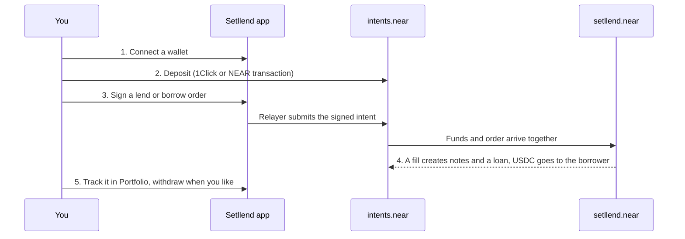

This page takes you from an empty wallet to your first fixed-rate order on the live app at https://www.setllend.xyz. It uses real funds on mainnet, so start with a small amount. Setllend has no minimum order size.

You need one of these:

- **An EVM wallet** (MetaMask, Rabby, or any browser wallet) with some USDC or ETH on **Arbitrum** or **Base**, plus a little ETH on that chain to pay for the deposit transfer. Nothing else: you never need NEAR tokens.
- **A NEAR wallet** (Meteor, MyNearWallet, or Intear) with some NEAR or USDC on NEAR. Keep about **0.15 NEAR** beyond what you deposit, for the NEAR transactions you send yourself (see [Wallets and accounts](wallets.md#keep-about-015-near-for-gas)).

## The five steps

### 1. Connect

1. Open https://www.setllend.xyz.
2. Click **Connect** in the top-right corner. The menu has two parts: **EVM wallet** (every browser wallet the app finds) and **NEAR wallet** (Meteor, MyNearWallet, Intear).
3. Pick your wallet and approve the connection.

The button now shows your account: the chain and short address for an EVM wallet, or your account ID for a NEAR wallet. The two kinds are separate Setllend accounts with separate balances. See [Wallets and accounts](wallets.md).

:::info Demo data
If the header shows a **Demo data** badge, the app could not reach the live backend and shows sample data. Actions are then simulated ("Demo: nothing is signed or sent"). Reload after a minute; the badge disappears once the backend answers.
:::

### 2. Deposit

Funds you lend or use as collateral first go into your **Intents balance**, your own balance on the `intents.near` ledger.

1. Open **Portfolio** in the header.
2. In **My Assets**, click **Deposit**.
3. Choose **From** (Arbitrum, Base, or NEAR), the **Asset**, and the **Amount**. Check the preview: what you send, what arrives, the 1Click fee, and the time.
4. Click **Deposit USDC** (or **Deposit ETH**, **Deposit NEAR**, **Buy NEAR**) and approve in your wallet.

A deposit from Arbitrum or Base goes through 1Click and usually arrives in about a minute. A deposit from a NEAR account is one NEAR transaction and arrives in seconds. The full flow, fees, and refunds are in [Deposit](../guides/deposit.md).

You can also skip this step: the order forms offer **New deposit**, which deposits exactly what the order needs before placing it.

### 3a. Lend: Start Earning

1. Go back to **Market**. Each card is one maturity, with its **Borrow Rate**, **Lend Rate**, **Max LTV**, and **Liquidity**.
2. Click **Start Earning** on the card you want.
3. Enter the **Lend amount** and the **Min rate (APR)**. The form prefills the best rate a lender can get right now. Check **Value at maturity** and **Interest earned**.
4. Under **Pay from**, keep **Intents balance** (or pick **New deposit**).
5. Click **Place lend order** and sign in your wallet.

Your USDC moves into the contract as an order. If a borrower's order already crosses your rate, it fills within seconds; otherwise it waits in the book. Details: [Lend](../guides/lend.md).

### 3b. Borrow

1. Make sure your collateral (ETH or NEAR) is in your Intents balance, or plan to use **New deposit**.
2. On a Market card, click **Borrow**.
3. Enter the **Borrow amount** in USDC and the **Max rate (APR)**.
4. Under **Collateral**, pick **Deposited** and enter how much of each token to lock. Use **+ Add token** to combine ETH and NEAR in one loan.
5. Check the **Health factor** bar, **Debt at maturity**, and **Borrow limit**. The order is blocked if the debt would pass the limit.
6. Click **Place borrow order** and sign.

When the order fills, the borrowed USDC lands in your Intents balance. Details: [Borrow](../guides/borrow.md).

### 4. Watch it fill

Open **Portfolio**. **All My Positions** shows your loans (Borrow tab), your notes (Lend tab), and your **Open Orders**. **History** lists every placement, fill, and transfer. An order that hasn't filled yet can be cancelled from Open Orders at any time, and the unused funds return to your Intents balance.

### 5. Take your money out

In **Portfolio → My Assets**, every token in your Intents balance has a **Withdraw** button. USDC goes to Arbitrum or Base through 1Click, or straight to your NEAR account if you use one. See [Withdraw](../guides/withdraw.md).

## What each action costs

| Item | Cost |
|---|---|
| Setllend | No fee. Orders, cancels, repayments, and redemptions are signed messages; Setllend's relayer pays the NEAR gas. |
| 1Click deposit or withdrawal (Arbitrum, Base) | A small 1Click fee, about 0.01% on USDC and ETH routes plus a destination-chain fee on withdrawals (a few thousandths of a USDC on recent withdrawals). The form shows the exact fee before you confirm. |
| Your own transfer on Arbitrum or Base | That chain's gas, paid by your wallet when it sends the deposit. |
| NEAR account only | The NEAR transactions you send yourself: deposits from NEAR, a one-time key registration, and a one-time USDC registration (0.00125 NEAR). |

## Next steps

- Understand what you hold: [Zero-coupon notes](../concepts/zero-coupon-notes.md) and [Rates and prices](../concepts/rates-and-prices.mdx).
- Before borrowing, read [Collateral and health](../concepts/collateral-and-health.mdx) and [Liquidation](../concepts/liquidation.mdx).
- Want out before maturity? [Exit early](../guides/exit-early.md) as a lender, or [manage your loan](../guides/manage-loan.md) as a borrower.
