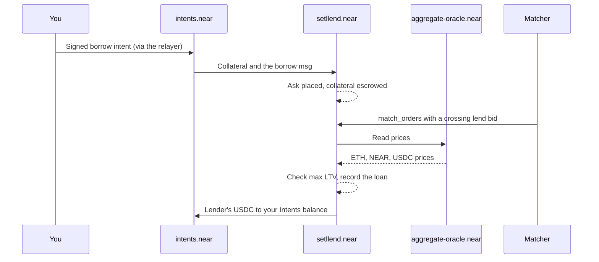

Borrowing on Setllend means **issuing notes against collateral**: you receive USDC now and owe a fixed amount, the **debt face**, at the maturity. The rate is fixed when your order fills, and you can repay part or all of it at any time ([Manage a loan](manage-loan.md)).

You place a **`borrow` order**: the USDC you want, a **maximum APR**, and the collateral that backs it. The order is an ask in that maturity's [order book](../concepts/order-book.md). It fills against lenders whose minimum rate is at or below your maximum.

## Key rules

- **One loan per maturity.** All your borrow fills in one maturity add up to one loan. A second borrow order in the same maturity increases that loan's debt.
- **Several collateral tokens in one loan.** A loan can hold ETH from Arbitrum, ETH from Base, and NEAR together. Each token has its own risk parameters; all three currently use 70% max LTV, 80% liquidation threshold, and a 5% liquidation bonus ([risk parameters](../reference/risk-parameters.md)).
- **Max LTV applies to the debt face**, the principal plus all interest to maturity, not just the principal. See [Collateral and health](../concepts/collateral-and-health.mdx).
- **Repay by maturity plus the 1-hour grace period.** After that, any unpaid debt can be liquidated, whatever its health ([Liquidation](../concepts/liquidation.mdx)).

## Where the collateral comes from

The **Collateral** section of the form has up to three sources:

| Source | What it does | What you sign |
|---|---|---|
| **New deposit** | Deposits each collateral token first (ETH from its own chain through 1Click; NEAR from your NEAR wallet, or bought with USDC through a 1Click swap for an EVM account), then places the order. | The deposit transfers, then one `transfer` intent that escrows the collateral with the order |
| **Deposited** | Uses collateral already in your Intents balance. The default when you hold a collateral token there. | One `transfer` intent that escrows the collateral with the order |
| **Existing loan** | Shown only when you already have a loan in this maturity. Borrows more against the collateral that loan already holds, adding none ("No new collateral. The loan's current collateral backs the extra debt."). | One `auth_call` intent; nothing is escrowed |

Before you connect, the form shows new deposits only.

## Place a borrow order

You can borrow from two places:

- **Market page:** click **Borrow** on a maturity's card. The modal is **Borrow USDC** ("Fixed rate until *date*").
- **Market detail page:** the **Borrow** tab of the order panel, with **Limit** and **Market** modes. Clicking a level under the lend offers in the **Order Book** opens Borrow at that rate.

Steps:

1. Enter the **Borrow amount** in USDC.
2. Enter the **Max rate (APR)**. It is prefilled with the market's **Borrow Rate**: the lowest rate a lender currently asks. A hint says whether the order fills now or waits in the book.
3. Under **Collateral**, pick the source: **New deposit**, **Deposited**, or **Existing loan**.
4. For **New deposit** or **Deposited**, enter an amount on each token row. With **Deposited**, each row shows "Deposited: … · Max". Click **+ Add token** to add another collateral token, and **×** to remove one. Frozen tokens can't be picked.
5. For **New deposit**, answer what the form asks: **Buy NEAR with USDC on** (Arbitrum or Base) if an EVM account adds NEAR, and **Your address on Arbitrum** or **Base** if a NEAR account deposits ETH (1Click refunds there). Each deposit shows a 1Click preview.
6. Check the **Health factor** bar and its liquidation prices ("Liquidation if, with the rest unchanged: … falls below …"), and the preview: **Debt at maturity** (or **New debt at maturity** and **Loan debt after** when you add to a loan), **Borrow limit** with the share used, and **Matures**.
7. Click **Place borrow order** and sign.

The modal then runs its steps: each deposit if you chose **New deposit**, the key registration for a new NEAR key, "Sign the borrow order with your wallet", and "Order placed. After a match, USDC arrives in your Intents balance".

:::tip Deposit first for a calmer order
A **New deposit** borrow waits for each deposit to arrive before the order is signed. If you prefer to see your collateral in place first, deposit from **Portfolio → Deposit** and then borrow from **Deposited**.
:::

### The health factor bar

The bar shows the loan's [health factor](../concepts/collateral-and-health.mdx) after this order, counting any loan you already have in this maturity:

```
health factor = Σ (collateral value × liquidation threshold) / debt face
```

It is labelled **Safe** from 1.50, **Moderate** from 1.20, and **Risky** below that. Below 1.00 a loan can be liquidated. The submit button is blocked with "Above your borrow limit" if the debt face would exceed the **borrow limit**, `Σ collateral value × max LTV`.

Prices in the preview are the oracle's conservative prices (collateral at price minus its confidence interval, debt at price plus it), the same ones the contract uses, so the preview runs the same check the contract runs at fill time. Prices can still move between the preview and the fill.

### Worked example

You borrow 1,000 USDC for 21 days at 8% APR against 0.75 ETH from Arbitrum, with ETH at $2,260.

| Figure | Calculation | Result |
|---|---|---|
| Debt at maturity | 1,000 × (1 + 0.08 × 21 / 365) | **1,004.60 USDC** |
| Collateral value | 0.75 × 2,260 | $1,695.00 |
| Borrow limit | 1,695.00 × 70% | $1,186.50 (85% used) |
| Health factor | 1,695.00 × 80% / 1,004.60 | **1.35** (Moderate) |
| Liquidation price | 1,004.60 / (0.80 × 0.75) | ETH below **$1,674.33** |

The smallest collateral for this loan at 70% max LTV is 1,004.60 / 0.70 = $1,435.14, about 0.635 ETH. Try your own numbers in the [health calculator](../concepts/collateral-and-health.mdx).

## What you sign

With **New deposit** or **Deposited**, one `transfer` intent escrows every collateral token with the order. Amounts are in base units (18 decimals for ETH, 24 for NEAR, 6 for USDC):

```json
{
  "intent": "transfer",
  "receiver_id": "setllend.near",
  "tokens": {
    "nep141:arb.omft.near": "750000000000000000",
    "nep141:wrap.near": "50000000000000000000000000"
  },
  "msg": "{\"action\":\"borrow\",\"data\":{\"maturity\":\"1795766400000000000\",\"max_rate_bps\":800,\"principal\":\"1000000000\",\"expires_at\":null}}"
}
```

This escrows 0.75 ETH from Arbitrum and 50 NEAR to borrow 1,000 USDC at up to 8.00% APR. With **Existing loan**, you sign an `auth_call` to `setllend.near` with the same `borrow` data and no tokens.

## What happens on chain



1. `intents.near` moves the collateral to `setllend.near` together with the order. An invalid order (a frozen token, a maturity that has passed, a token listed twice) is refunded in full automatically.
2. No price is checked when the order is placed. It is checked at each fill.
3. When the matcher finds a crossing lend bid, it calls `match_orders`. The contract reads the oracle once for the batch and checks that your **whole loan**, after the fill, stays within max LTV at conservative prices.
4. On a fill, the contract adds the debt face (rounded up to the smallest USDC unit) to your loan, moves the matching share of your escrowed collateral into it, and sends the lender's USDC to your **Intents balance**.

The fill rate is the **maker's** rate: if a lender's order was resting at 6.5% and your max is 8%, you pay 6.5%. If your order rests and a lender crosses it later, you pay your own max rate. See [Order book](../concepts/order-book.md).

## Partial fills

A borrow order can fill in pieces. Each fill moves collateral into the loan in proportion: a fill of 40% of what is left moves 40% of each escrowed token. The fill that completes the order moves all remaining escrow. The rest of the order waits in **Open Orders**.

**Cancel** returns the escrow that is left to your Intents balance ("… collateral returns to your Intents balance"). Collateral that already moved into the loan stays there; take it out with [Withdraw collateral](manage-loan.md#withdraw-collateral). A borrow against an existing loan escrows nothing, so its cancel returns nothing.

A fill can also wait even when rates cross:

- **The collateral no longer covers the debt** at current prices (a price drop since you placed the order). The fill is skipped and the order waits.
- **The oracle has no fresh price.** Fills against borrow orders wait until it does. Note sales still fill against lend orders.

## Get the USDC out

Borrowed USDC arrives in your Intents balance, shown in **Portfolio → My Assets** as USDC under **Deposited · Intents balance**. From there, **Withdraw** sends it to Arbitrum or Base through 1Click, or to your NEAR account. See [Withdraw](withdraw.md). You can also leave it there to repay later.

## Timing and fees

- A crossing order usually fills within seconds; the matcher runs on every book change and every 5 seconds.
- Setllend charges no fee and the relayer pays gas. **New deposit** adds 1Click fees, and an EVM account buying NEAR pays the swap fee ([Deposit](deposit.md#fees-and-timing)).

## When something goes wrong

| What you see | Meaning | What to do |
|---|---|---|
| "Enter collateral" | No collateral amount entered. | Enter an amount on at least one token row, or pick **Existing loan**. |
| "More than your deposit" | A **Deposited** row asks for more than your balance holds. | Use **Max** or deposit more. |
| "Above your borrow limit" | The debt face would exceed `Σ value × max LTV`. | Borrow less, add collateral, or pick an earlier maturity, which adds less interest. |
| "Not done" with a reason | The relayer's simulation or the contract rejected the order. A rejected `transfer` is refunded in full. | Fix the cause and **Try again**. |
| A deposit step failed | 1Click refunded or the quote expired. Collateral that already arrived stays in your Intents balance. | **Try again** resumes from the failed deposit; deposits that arrived are not sent again. |
| A step marked **?** | The outcome isn't known. | Check **History** and **Open Orders** before signing again. |
| The order rests unfilled | No lender crosses your max rate, prices moved against you, or the oracle is stale. | Wait, raise your max rate, or cancel and place a new order with more collateral. |

## Next

- Watch and manage the loan: [Manage a loan](manage-loan.md).
- Understand liquidation before you need to: [Liquidation](../concepts/liquidation.mdx).
- The owner can change a token's risk parameters, effective at once for open loans. Keep a margin above health 1.00. See [Risks](../how-it-works/risks.md).
