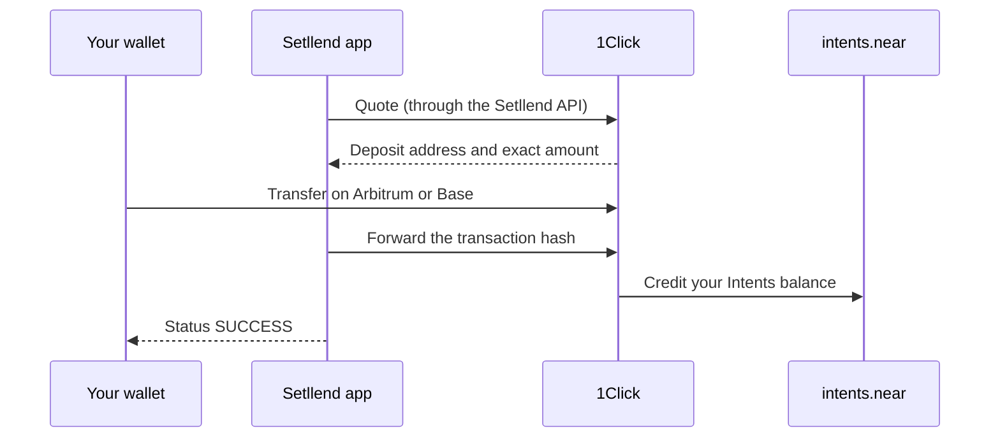

Before you can lend, post collateral, or repay, the funds must be in your **Intents balance**, your own balance on the `intents.near` ledger. A deposit puts them there. Deposited funds are yours and stay in your balance until you sign an action; they are **not collateral** until you add them to a loan or use them in a borrow order.

There are two ways to deposit:

- **From Portfolio:** **Portfolio → My Assets → Deposit**, described on this page.
- **Inside an order form:** Lend, Borrow, and Repay offer **New deposit**, which deposits exactly what the action still lacks and then signs the action. The deposit part works the same as below.

## What you can deposit

| From | Asset | How | Arrives as |
|---|---|---|---|
| Arbitrum | USDC | 1Click | USDC (NEAR native USDC, the market's debt asset) |
| Arbitrum | ETH | 1Click | ETH · Arbitrum (collateral) |
| Arbitrum | NEAR, bought with USDC or ETH | 1Click swap | NEAR (collateral) |
| Base | USDC | 1Click | USDC (NEAR native USDC) |
| Base | ETH | 1Click | ETH · Base (collateral) |
| Base | NEAR, bought with USDC or ETH | 1Click swap | NEAR (collateral) |
| NEAR account | NEAR | One NEAR transaction | NEAR (collateral) |
| NEAR account | USDC | One NEAR transaction | USDC |

USDC from Arbitrum or Base is converted 1:1 (less the 1Click fee) to native NEAR USDC, the only asset lent and borrowed. ETH keeps its origin: ETH from Arbitrum and ETH from Base are two separate collateral tokens, and each one withdraws only to its own chain.

**1Click** is the NEAR Intents service that moves assets between chains and the `intents.near` ledger. You send funds to a one-time deposit address on the source chain, and 1Click credits the asset to your Intents balance.

## Deposit from Arbitrum or Base

1. Open **Portfolio** and click **Deposit** in **My Assets**. The modal is titled **Deposit**: "Into your Intents balance. Not collateral until you add it".
2. Set **From** to **Arbitrum** or **Base**.
3. Pick the **Asset**: **USDC**, **ETH**, or **NEAR**. For NEAR, also pick **Pay with** (**USDC** or **ETH**): 1Click swaps it to NEAR.
4. Enter the **Amount** (for NEAR, **You pay**, in the asset you pay with).
5. **NEAR account only:** enter **Your address on Arbitrum** (or Base). A NEAR account has no address on EVM chains, and 1Click refunds there if the deposit can't complete. An EVM account uses its own address.
6. Check the preview: **You send**, **Arrives**, **1Click fee** (for same-asset routes), and **Time**. **Advanced** shows the slippage tolerance: 0.5% by default, 1% for swaps to NEAR.
7. Click **Deposit USDC**, **Deposit ETH**, or **Buy NEAR**.
8. Send the funds:
   - **EVM account:** your wallet switches to the source chain if needed and asks you to confirm the transfer of the exact amount to the 1Click deposit address. The app waits for the transfer to be in a block, then tells 1Click about it.
   - **NEAR account:** the modal shows "Send exactly *amount* on *chain* to *address*", with **Copy address**. Send that amount from any wallet on that chain. Send every digit shown: a rounded-down amount arrives short and 1Click cannot complete it.
9. Wait for the step to reach "arrived". The modal follows the 1Click status and shows links to the source-chain transaction and the NEAR transaction.

## Deposit from a NEAR account

1. In the Deposit modal, set **From** to **NEAR**.
2. Pick **NEAR** or **USDC** and enter the **Amount**.
3. Click **Deposit NEAR** or **Deposit USDC** and approve **one NEAR transaction** in your wallet.

For NEAR, the transaction goes to `wrap.near`: it wraps the NEAR (`near_deposit`) and sends it to `intents.near` (`ft_transfer_call`) in one go, plus a one-time `storage_deposit` of 0.00125 NEAR if your account has never held wrapped NEAR. For USDC, it is one `ft_transfer_call` on the USDC contract. The `msg` of the transfer names the Intents account to credit. There is no 1Click step, and the funds arrive in seconds.

You pay this transaction's gas. Keep about 0.15 NEAR beyond what you deposit, or NEAR refuses the transaction before it runs (see [Wallets and accounts](../getting-started/wallets.md#keep-about-015-near-for-gas)).

An **EVM account** can use this route too. With **From: NEAR**, the modal asks for a NEAR wallet ("Sending from NEAR needs a NEAR wallet. It only signs this deposit; … receives it.") and lists the NEAR wallets. The connected NEAR wallet sends and pays for the transaction, and the funds are credited to your active EVM account.

## Fees and timing

| Route | Fee | Typical time |
|---|---|---|
| USDC from Arbitrum or Base | About 0.01% (1Click with Setllend's partner key on stablecoin routes). For example, a 1 USDC deposit from Base arrived as 0.999798 USDC. | About 1 minute after your transfer is in a block |
| ETH from Arbitrum or Base | At most about 0.01% (same-asset route; quotes delivered 0.01 ETH for 0.01 ETH) | About 25 seconds in quotes |
| NEAR bought with USDC or ETH | About 0.20% for the swap, plus the price slippage of the swap | About 25 to 35 seconds in quotes |
| NEAR or USDC from a NEAR account | No fee, only NEAR gas | Seconds |

Setllend itself charges nothing for deposits. Your wallet also pays the source chain's gas for the transfer. The preview shows the live quote, so trust it over this table.

**Exact output inside order forms.** When **New deposit** funds an order or a repayment, the app asks 1Click for the exact amount that must arrive. You then send a little more, which covers the slippage tolerance. The 1Click fee shown in the preview leaves that buffer out, because 1Click refunds the unused part to your refund address on the source chain.

## Deposited is not collateral

Deposits show in **My Assets** as **Deposited · Intents balance**, marked **Not collateral**. To use them:

- **Lend:** pick **Intents balance** under **Pay from** in a lend order ([Lend](lend.md)).
- **Borrow:** pick **Deposited** under **Collateral** in a borrow order ([Borrow](borrow.md)).
- **Top up a loan:** click **Add to collateral** next to the deposit ([Manage a loan](manage-loan.md#add-collateral)).
- **Leave:** click **Withdraw** next to it ([Withdraw](withdraw.md)).

## When something goes wrong

| What you see | What happened | What to do |
|---|---|---|
| "1Click refunded it: …" or "1Click couldn't complete it (FAILED)" | 1Click could not deliver, for example because the amount arrived short. It refunds to your refund address on the source chain (your own address for an EVM account, the address you entered for a NEAR account). | Check the refund on the source chain. **Try again** gets a new quote. |
| "The 1Click quote expired before a deposit arrived. Try again for a new one." | No transfer reached the deposit address in time. | **Try again**. Never send to an old deposit address. |
| "The transfer on Arbitrum reverted, so nothing was sent" | Your transfer failed on the source chain, usually for lack of gas or balance. | Fix the balance and **Try again**; the same quote is reused. |
| "Cancelled in the wallet" | You rejected the transfer. | **Try again** sends the same quote again. |
| A step marked **?** with "the transaction may have gone out" | The NEAR wallet reported an error that doesn't say whether the transaction was sent. | Don't retry blindly. Check your balances and **History** first. |
| "1Click is temporarily unavailable" in the preview or a step | 1Click is paused or under maintenance. | Wait and retry later. Deposits from a NEAR account don't use 1Click. |

Closing the modal stops the app from watching, not what was sent: a deposit in flight still arrives and shows in **History** under **Transfers**. A retry starts from the failed step, so a deposit that already arrived is never sent twice.
