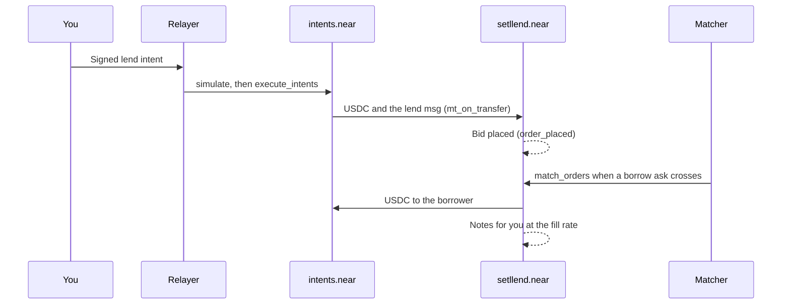

Lending on Setllend means buying **notes**: claims to receive 1 USDC each at the maturity. You pay less than face value now and receive face value at maturity, so your interest is fixed the moment your order fills. If you need the money earlier, you can sell the notes on the same book ([Exit early](exit-early.md)).

You place a **`lend` order**: an amount of USDC and a **minimum APR**. The order is a bid in that maturity's [order book](../concepts/order-book.md). It fills against borrowers (and lenders selling notes) whose maximum rate is at or above your minimum.

## Before you start

- USDC in your Intents balance ([Deposit](deposit.md)), or use **New deposit** in the form.
- A NEAR account signs its first action after registering its key (one NEAR transaction, once). See [Wallets and accounts](../getting-started/wallets.md#register-your-key-on-near-intents-once).

## Place a lend order

You can lend from two places:

- **Market page:** click **Start Earning** on a maturity's card. The modal **Start Earning** ("Fixed rate until *date*") places a limit order.
- **Market detail page:** click **View Market for Details** on a card, then use the **Lend** tab of the order panel, which also has a **Market** mode. Clicking a level under the borrow requests in the **Order Book** opens Lend at that level's rate.

Steps:

1. Enter the **Lend amount** in USDC.
2. Enter the **Min rate (APR)** in percent. It is prefilled with the market's **Lend Rate**: the highest rate a borrower (or a lender selling notes) currently offers. A hint tells you whether the order fills now or "Waits in the book. Market rate is …".
3. Under **Pay from**, choose **Intents balance** (the default when it covers the amount; **Max** fills in your whole balance) or **New deposit**. With **New deposit**, pick **Pay USDC from** (Arbitrum, Base, or NEAR for a NEAR account). If your balance covers part of it, the form says "Uses your … balance and deposits the rest."
4. Check the preview: **Value at maturity**, **Interest earned**, and **Matures**.
5. Click **Place lend order** and sign in your wallet.

The steps then run in the modal: the deposit if you chose one, "Register your key on NEAR Intents (first time only)" for a new NEAR key, "Sign the lend order with your wallet", and "Order placed in the book". The result card links to the transaction on nearblocks.

### Worked example

You lend 1,000 USDC at a minimum of 6.00% APR, 21 days before maturity, and the order fills at 6.00%.

- Value at maturity = 1,000 × (1 + 0.06 × 21 / 365) = **1,003.45 USDC**
- Interest earned = **3.45 USDC**

The contract rounds a lender's note value down to the smallest USDC unit, so the exact figure can be one millionth of a USDC below the preview. Try other numbers in [Rates and prices](../concepts/rates-and-prices.mdx).

### Market mode

On the market detail page, **Market** mode fills your amount against the book right now. It is a shortcut, not a different order type: the app places a limit order at the rate of the last book level needed to fill the amount. The form shows the **Average rate (APR)** you get, since each level fills at its own rate. If the book holds less than your amount, the hint says "Only … USDC in the book. The rest waits at …%", and the rest stays in the book at that rate. With nothing on the other side, the button reads "No orders to fill. Use Limit".

## What you sign

One intent: a `transfer` of USDC from your Intents balance to `setllend.near`, with the order in its `msg`.

```json
{
  "intent": "transfer",
  "receiver_id": "setllend.near",
  "tokens": {"nep141:17208628f84f5d6ad33f0da3bbbeb27ffcb398eac501a31bd6ad2011e36133a1": "1000000000"},
  "msg": "{\"action\":\"lend\",\"data\":{\"maturity\":\"1795766400000000000\",\"min_rate_bps\":700,\"expires_at\":null}}"
}
```

`1000000000` is 1,000 USDC in base units (6 decimals), and `min_rate_bps` is the minimum APR in basis points (700 = 7.00%). The app sets no expiry (`expires_at: null`), so the order rests until it fills or you cancel it.

## What happens on chain



1. The relayer checks your payload, simulates it, and submits it with `execute_intents`. It pays the gas.
2. `intents.near` verifies your signature, moves the USDC to `setllend.near`, and calls the contract with your `msg`. The USDC and the order arrive in one step: there is no moment where the funds are in the contract without the order.
3. The contract records the bid and emits `order_placed`. If the order is invalid (for example a maturity that has passed), the contract rejects it and `intents.near` refunds the full amount to your Intents balance automatically.
4. The matcher watches the books. When your bid crosses an ask, it calls `match_orders`. The contract checks the fill again: the rates cross, the owners differ, the maturity is still ahead, and for a borrower, that their collateral covers the new debt at oracle prices.
5. On a fill, your USDC goes to the borrower's Intents balance, and you receive notes worth `principal × (1 + rate × time left / 365 days)` at maturity.

## Which rate you get

Your **Min rate** is a limit, not necessarily the rate you get. Every fill happens at the rate of the **maker**, the order that was in the book first:

- Your order **rests** in the book and a borrower with a max rate of 8% crosses it: you get **your own rate** (6%, say).
- A borrower's order **rests** at 8% and you place a lend order with a min of 6%: you get **8%**, the resting order's rate.

The matcher never chooses the rate. It only pairs orders and sizes the fills, and the contract enforces the maker's rate. See [Order book](../concepts/order-book.md).

## Partial fills

A lend order can fill in several pieces, against several borrowers or note sellers, and at several rates. Each fill creates notes at its own rate. Whatever is left waits in the book, and **Open Orders** shows it under **Remaining**. Your notes from all fills in one maturity add up into one position in **Portfolio → All My Positions → Lend**, with the average rate.

Your lend order never fills against your own borrow or sell order: the contract rejects self-trades.

:::tip Lending where you also borrow
If you have a loan in the same maturity, the notes your lend order buys **cancel your debt automatically** instead of staying as notes. This netting is the cheapest way to repay early. See [Manage a loan](manage-loan.md#repay-early-for-less-by-lending-in-the-same-maturity).
:::

## Cancel an order

You can cancel what has not filled at any time, also after the maturity has passed.

1. Open **Open Orders**: in **Portfolio → All My Positions**, or in **Your activity in this market** on the market detail page.
2. Click **Cancel** on the order. The modal **Cancel order** says what returns, for example "$400.00 returns to your Intents balance".
3. Click **Cancel order** and sign.

The cancel is an `auth_call` intent with `{"action":"cancel","data":{"order_id":"42"}}`. The contract removes the order and pays the remaining USDC back to your Intents balance. The filled part stays as notes.

An order that is still open when its maturity arrives can no longer fill. Cancel it to get the USDC back.

## Timing and fees

- **Placing:** the relayer usually answers within seconds. If the transaction takes longer than 30 seconds, the step shows "Sent to NEAR Intents. Still processing…" and the app keeps waiting for up to about 11 minutes.
- **Filling:** the matcher runs whenever a book changes and every 5 seconds, so a crossing order usually fills within seconds.
- **Fees:** Setllend charges nothing, and the relayer pays the gas. A **New deposit** from Arbitrum or Base adds 1Click's small fee ([Deposit](deposit.md#fees-and-timing)).

## When something goes wrong

| What you see | Meaning | What to do |
|---|---|---|
| "More than your Intents balance" | The amount is above your USDC balance. | Lower it, use **Max**, or pick **New deposit**. |
| A red "Not done" card with a reason, and **Try again** | The relayer's simulation or the contract rejected the order, for example "insufficient balance or overflow". Nothing was taken: a rejected order is refunded in full. | Fix the cause and **Try again**, which signs a fresh intent. |
| A step marked **?**: "The relayer didn't answer" or "The result didn't reach this page" | The app doesn't know whether the order went through. | Check **History** and **Open Orders** before signing again, so you don't place it twice. |
| The order sits in the book | No borrower crosses your minimum yet. | Wait, lower your minimum, or cancel. |

## What you can do next

- Track your notes in [Portfolio](portfolio.md).
- Sell them before maturity: [Exit early](exit-early.md).
- Collect at maturity: [Redeem](redeem.md).
- Know the risk: if a borrower's collateral can't cover their debt, every lender in that maturity shares the loss. See [Bad debt](../concepts/bad-debt.md).
