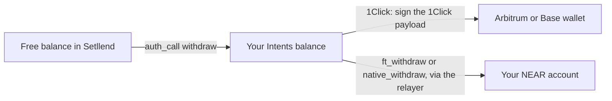

Everything you hold outside the contract, including borrowed USDC, sell-order proceeds, and cancelled orders, sits in your **Intents balance** on `intents.near`. A withdrawal moves it out to a wallet: to **Arbitrum** or **Base** through 1Click, or, for a NEAR account, straight to **your NEAR account**. Each withdrawal is one signature (plus a one-time registration for USDC to a NEAR account).

## Where each token can go

| Token in your balance | To Arbitrum or Base | To your NEAR account |
|---|---|---|
| USDC | Yes, as that chain's USDC, through 1Click | Yes, as USDC, with an `ft_withdraw` intent (NEAR accounts only) |
| NEAR | Yes, **swapped to USDC** by 1Click | Yes, as native NEAR, with a `native_withdraw` intent (NEAR accounts only) |
| ETH · Arbitrum | Arbitrum only, as ETH, through 1Click | No |
| ETH · Base | Base only, as ETH, through 1Click | No |

An EVM account withdraws to its own address on Arbitrum or Base. A NEAR account enters an address on those chains ("Your address on Arbitrum"), since it has none there.

## Withdraw from your Intents balance

1. Open **Portfolio → My Assets**. Rows marked **Deposited · Intents balance** are your Intents balance.
2. Click **Withdraw** on the token. The modal **Withdraw** says "Deposited balance, not collateral".
3. Enter the **Amount**; **Max** takes the exact whole balance.
4. For USDC or NEAR, pick **Send to**: **NEAR** (NEAR accounts only, the default for them), **Arbitrum**, or **Base**. ETH shows "Goes back to Arbitrum, the chain it came from" (or Base).
5. A NEAR account sending to Arbitrum or Base enters **Your address on** that chain.
6. Click **Withdraw USDC** (or **Withdraw ETH**, **Withdraw NEAR**) and follow the steps.



## To Arbitrum or Base, through 1Click

1. **Quote.** The app asks 1Click, through Setllend's API, for a quote of exactly your amount. The step reads "Withdraw USDC to Base: getting a 1Click quote".
2. **Check.** 1Click returns a payload to sign. Setllend's backend checks that it holds exactly **one transfer of your amount** from your Intents balance to 1Click's deposit address, and nothing else, before showing it to you.
3. **Sign.** "Withdraw USDC to Base: sign the withdrawal in your wallet". An EVM wallet signs with `personal_sign`, a NEAR wallet with `signMessage`. A NEAR key that isn't registered yet is registered first.
4. **Submit and follow.** The backend submits the signed payload to 1Click, and the step follows its status: "1Click is sending it", then "sent". The result links to the destination-chain transaction when 1Click reports it.

The payload you sign looks like this (the receiver is 1Click's deposit address, a 64-character NEAR account):

```json
{
  "signer_id": "0xabc…",
  "verifying_contract": "intents.near",
  "deadline": "…",
  "nonce": "…",
  "intents": [
    {"intent": "transfer", "receiver_id": "<1Click deposit address>", "tokens": {"nep141:17208628f84f5d6ad33f0da3bbbeb27ffcb398eac501a31bd6ad2011e36133a1": "5000000"}}
  ]
}
```

If 1Click can't complete the swap, its status ends as `REFUNDED` or `FAILED` and the funds return to your **Intents balance**; the step says "… It went back to your Intents balance". **Try again** gets a new quote.

## To your NEAR account

Available for NEAR accounts. No 1Click is involved: the withdrawal is a NEAR Intents intent that sends the funds from your Intents balance to your own account, submitted by the relayer.

**USDC:**

1. **Register on USDC (first time only, 0.00125 NEAR).** A NEAR account can receive a token only after registering storage on that token's contract. The app checks this first. If your account isn't registered, you approve one `storage_deposit` transaction on the USDC contract from your wallet, 0.00125 NEAR, which you pay. After that the step is skipped.
2. **"Sign the withdrawal of USDC to your NEAR account".** You sign an `ft_withdraw` intent:
   ```json
   {"intent": "ft_withdraw", "token": "17208628f84f5d6ad33f0da3bbbeb27ffcb398eac501a31bd6ad2011e36133a1", "receiver_id": "<your account>", "amount": "5000000"}
   ```
3. **"USDC sent to your NEAR account".** The relayer submits it; the USDC arrives in seconds.

**NEAR:** you sign a `native_withdraw` intent (`{"intent": "native_withdraw", "receiver_id": "<your account>", "amount": "<yoctoNEAR>"}`), and the NEAR arrives as native NEAR, not wrapped. No registration is needed.

A withdrawal to a NEAR account is always to the signer's own account and is signed alone, never together with another action. The relayer checks before submitting that your account can receive the funds (registered on USDC, or existing for NEAR to a named account), so a withdrawal that would fail isn't sent.

## Free balances from failed payouts

When the contract pays you, for example on a cancel, a collateral withdrawal, a redemption, or a fill, it sends the tokens to your Intents balance. If that transfer fails, nothing is lost: the contract keeps the tokens for you as a **free balance** in Setllend and emits `payout_failed`. History shows it as "Payout of … failed", and the action's result says the funds wait in the free balance.

Free balances appear in **My Assets** as **Setllend · free balance**.

1. Click **Withdraw** on the row. The modal says "Free balance held by Setllend".
2. Enter the amount and the destination, as above.
3. Sign "Sign the Setllend withdrawal with your wallet": an `auth_call` with `{"action":"withdraw","data":{"token_id":"…","amount":null}}` (`null` takes the whole free balance). The tokens return to your Intents balance.
4. The exit to your chain or NEAR account follows, as above.

## Fees and timing

| Route | Fee | Typical time |
|---|---|---|
| USDC to Base | About 0.01% plus Base's withdraw fee. For example, 0.999798 USDC arrived as 0.997196 USDC. | About 10 to 30 seconds after you sign |
| USDC to Arbitrum | About 0.01% plus Arbitrum's withdraw fee (about 0.005 USDC observed). For example, 0.999799 USDC arrived as 0.994297 USDC. | About 10 to 30 seconds |
| ETH to its own chain | A very small withdraw fee (0.00000056 ETH on a 0.01 ETH quote to Base) | About 10 seconds in quotes |
| NEAR to Arbitrum or Base, as USDC | About 0.20% for the swap, plus its price slippage | About 12 seconds in quotes |
| USDC or NEAR to your NEAR account | No fee; 0.00125 NEAR once for the USDC registration | Seconds |

Setllend itself charges nothing, and the relayer pays the gas for intents. The destination-chain fee is roughly fixed, so it weighs more on small amounts.

## When something goes wrong

| What you see | Meaning | What to do |
|---|---|---|
| "1Click refunded it … It went back to your Intents balance" | 1Click could not complete the swap. | **Try again** for a new quote. |
| "The withdrawal may have been sent (…). Check your History and balances before trying again." | 1Click didn't answer the submit. | Don't sign again until **History** or your balances show the outcome. |
| "Your NEAR account doesn't exist on chain yet. Withdraw some NEAR to it first, which creates it, then try again." | An implicit NEAR account with no NEAR can't send the USDC registration. | Withdraw some NEAR to the account first, then the USDC. |
| "This withdrawal needs the EVM wallet that owns the account" | The active account changed between quote and signature. | Switch back to the EVM wallet and try again. |
| A withdrawal shows **Unknown** in History | The relayer could not confirm the outcome. | Check your Intents balance and your NEAR account; the hint on the row says the same. |
| "The payout went to your free balance in Setllend, not your Intents balance." | A Setllend payout failed before the exit, so the exit stopped. | Withdraw the free balance from **My Assets**. |
