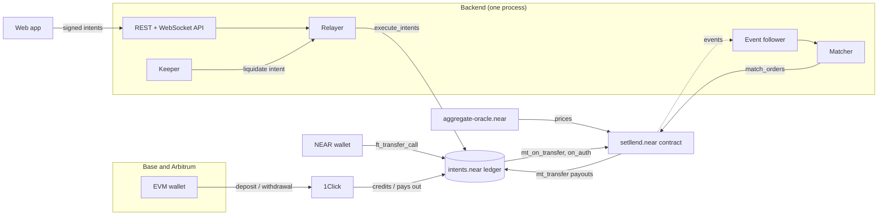
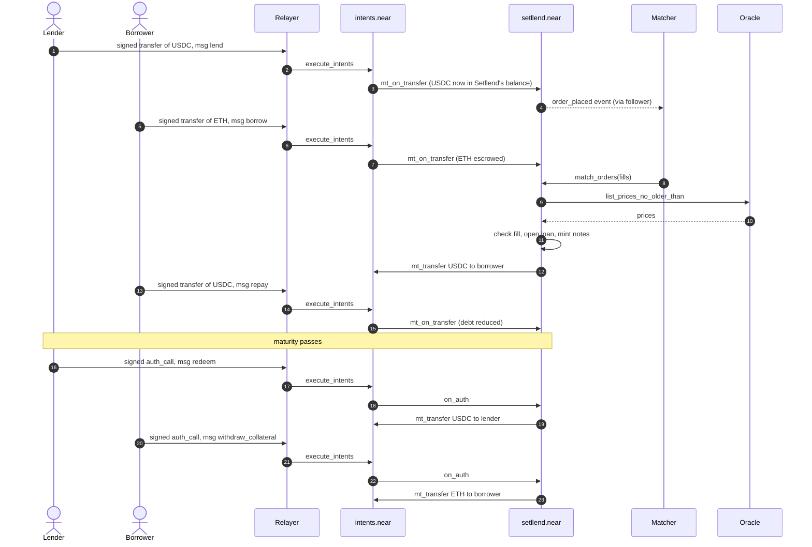

Setllend has three layers. User funds live on the **`intents.near` ledger** (the NEAR Intents Verifier contract on NEAR mainnet). The **Setllend contract** (`setllend.near`) holds order escrow, loans, and notes, and enforces every lending rule. A **backend** run by the operator matches orders, submits transactions so users pay no gas, and liquidates loans that need it. Cross-chain money moves in and out through **1Click**, the NEAR Intents swap and bridge API, and prices come from Rhea's **`aggregate-oracle.near`**.

This page shows how those pieces connect, the principles behind the design, and one full loan from deposit to redemption.

## System diagram

Read it left to right:

1. A user brings USDC (to lend) or collateral (ETH or NEAR, to borrow) into their **Intents balance**, their balance on the `intents.near` ledger. From Base or Arbitrum this goes through 1Click. From a NEAR wallet it is a direct `ft_transfer_call` to `intents.near`. See [Money flows](./money-flows.md).
2. To place an order, the user **signs** a NEAR Intents message in their wallet. The app sends it to the backend's relayer, which submits it to `intents.near`. The Verifier checks the signature and moves the funds to the Setllend contract's own balance on the same ledger, then calls the contract with the order.
3. The matcher pairs crossing orders and calls `match_orders` on the contract. The contract asks the oracle for prices, checks every fill, records the loan and the lender's notes, and pays the borrowed USDC to the borrower's Intents balance.
4. Repayments, redemptions, cancels, and withdrawals are more signed intents. Payouts from the contract are `mt_transfer` calls on `intents.near`, from the contract's balance to the user's.

## Design principles

### Funds stay on the `intents.near` ledger

Every token Setllend handles is a balance on `intents.near`. A user's free funds are in their own Intents account. Funds committed to Setllend (open orders, loan collateral, USDC waiting for redemption) are in the Setllend contract's Intents account, and the contract's own records say whose they are. Nothing moves to another chain until the user withdraws.

This keeps every Setllend action on one ledger, inside one NEAR transaction, with no bridge in the middle of a trade. It also means a borrower on Arbitrum and a lender on Base meet in the same book: both are just accounts on `intents.near`.

### Orders are escrowed on chain, matching happens off chain

Placing an order sends its funds to the contract, which stores the order: its owner, kind, maturity, rate limit, size, and escrowed tokens. Anyone can read every open order with the contract's views, so the order book is public state, not a private database.

Matching, which needs a sorted book and many small decisions, runs off chain in the matcher. The matcher only proposes pairs. The contract checks each proposed fill (the orders cross, the maturity is open, the borrower's collateral covers the debt at current prices) and sets the fill rate itself: the limit rate of the order placed first (the **maker rate**). `match_orders` is permissionless, so anyone can run a matcher. See [Order book](../concepts/order-book.md) and [Matching](../developers/contract/matching.md).

### The contract doesn't verify signatures

Users never call the Setllend contract directly. `intents.near` verifies every signature (ERC-191 for EVM wallets, NEP-413 for NEAR wallets), the nonce, and the deadline, and only then calls Setllend. The contract's two user entry points, `mt_on_transfer` and `on_auth`, refuse any caller other than `intents.near` (`Caller must be the intents contract`). The account the Verifier names as the signer is the account the contract acts for. See [NEAR Intents](./near-intents.md).

### Gasless for users

Users only sign messages. The relayer submits each signed intent in a NEAR transaction from the operator's account `backend.setllend.near` and pays the gas. An EVM user never needs a NEAR account, NEAR tokens, or a NEAR wallet. A NEAR wallet user signs messages the same way; the only NEAR transactions they send themselves are a one-time key registration, deposits from their NEAR account, and storage registration before a first USDC withdrawal to it.

## Components

| Component | Where | Role |
|---|---|---|
| Setllend contract | `setllend.near`, code in `contracts/setllend/` | Order escrow, loans and notes, fill checks and rates, health factor, repay, liquidation, maturity redemption, the collateral token list |
| `intents.near` | NEAR Intents Verifier (not ours) | Holds every balance, verifies signatures, nonces, and deadlines, forwards orders and actions to Setllend, executes payouts |
| `aggregate-oracle.near` | Rhea's oracle (not ours) | USD prices for USDC, ETH, and NEAR, read by the contract when a `borrow` fill, a liquidation, or a collateral withdrawal with open debt needs them |
| 1Click | NEAR Intents swap API (not ours) | Deposits from Base and Arbitrum into Intents balances, and withdrawals back |
| Event follower | `backend/src/chain/` | Reads the contract's transactions and event logs from the FastNear explorer and tells the books when to reload |
| Matcher | `backend/src/matcher/` | One in-memory book per maturity, copied from the contract's views; builds fills and calls `match_orders` |
| Relayer | `backend/src/relayer/` | Checks and simulates each signed intent, submits it with `execute_intents`, pays gas, reports the outcome |
| Keeper | `backend/src/keeper/` | Scans every loan every 10 seconds and liquidates loans that are unhealthy or overdue past maturity plus the grace period |
| 1Click wrapper | `backend/src/oneclick/` | Quotes, deposit tracking, withdrawal payloads, and status polling for 1Click |
| REST + WebSocket API | `backend/src/app.ts`, `ws.ts` | Books, trades, accounts, prices, and live pushes for the app; [REST API](../developers/rest-api.md), [WebSocket API](../developers/websocket-api.md) |
| Web app | https://www.setllend.xyz, code in `frontend/` | EVM and NEAR wallet login, markets, order forms, portfolio, deposits and withdrawals |

All backend components run in one Node.js process. [Backend services](./backend-services.md) explains each one, what it reads, and what happens when it stops.

## One loan, start to finish

A lender and a borrower, both already holding funds in their Intents balances, meet in one maturity. The borrower repays before maturity and the lender redeems after it.

What happens at each stage:

1. **Lend order (steps 1 to 4).** The lender signs a `transfer` intent of 1,000 USDC to `setllend.near` with the `msg` `{"action":"lend","data":{"maturity":"1795766400000000000","min_rate_bps":500,"expires_at":null}}`. The relayer simulates it, then submits it. `intents.near` moves the USDC to the contract's balance and calls `mt_on_transfer`, which stores the order and emits `order_placed`. If the `msg` is invalid, the contract panics and `intents.near` refunds the full amount in the same transaction.
2. **Borrow order (steps 5 to 7).** The borrower signs a `transfer` of ETH with a `borrow` `msg` (`max_rate_bps`, `principal`). The ETH is escrowed in the order.
3. **Match (steps 8 to 12).** The orders cross (5% ≤ the borrower's maximum, say 6%). The matcher sends a fill such as `{"bid":"7","ask":"8","principal":"500000000"}`. The contract fetches prices, checks the borrower's collateral against each token's max LTV, and fills at the maker rate, the lender's 5%. It opens the loan with a debt face (USDC owed at maturity) of principal plus simple interest, for example 500 USDC for 30 days at 5% gives a face of 500 × (1 + 0.05 × 30/365) ≈ 502.05 USDC. The lender receives notes worth that face, and the borrower receives 500 USDC in their Intents balance.
4. **Repay (steps 13 to 15).** The borrower signs a USDC `transfer` with a `repay` `msg`. The USDC goes into the maturity's redemption pool and the debt face drops. Paying more than the debt refunds the rest.
5. **Redeem (steps 16 to 19).** After maturity the lender signs an `auth_call` with a `redeem` `msg`. The contract burns the notes and pays their value in USDC from the pool.
6. **Collateral back (steps 20 to 23).** With no debt left, `withdraw_collateral` needs no price and pays the ETH back to the borrower's Intents balance. From there the borrower can withdraw it to Arbitrum through 1Click.

If the borrower doesn't repay by maturity plus the 1-hour grace period, or if the loan's health factor falls below 1 before that, the keeper liquidates it: it pays USDC into the pool and receives collateral plus the liquidation bonus. See [Liquidation](../concepts/liquidation.mdx).

A lender who wants out before maturity places a `sell_note` order, which a new lender's bid buys. A borrower can repay at any time. See [Exit early](../guides/exit-early.md).
