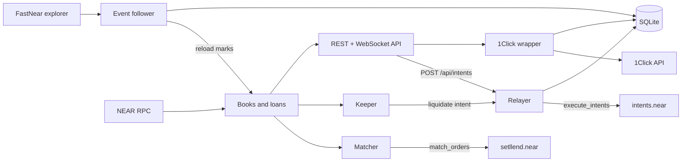

The Setllend backend is one Node.js process (TypeScript, in `backend/`). It holds no user funds and has no special power in the contract: it reads public state, proposes fills that the contract checks, and submits transactions that users signed. Everything it does, anyone else can do too.

## Event follower

The follower tells the rest of the backend that something changed on chain.

- Every 5 seconds it reads the latest final block from NEAR RPC, then lists the transactions that touch the Setllend contract from the **FastNear explorer API** (`tx.main.fastnear.com`), oldest first, and fetches their receipts and logs.
- It keeps only receipts executed by the Setllend contract with a success status. A receipt that fails can still carry logs it wrote before failing, so those are ignored.
- It parses each log as a Setllend event (`order_placed`, `order_filled`, `repaid`, and so on; see [Events](../developers/contract/events.md)) and stores it in SQLite, keyed by receipt and log index, so reading a transaction twice stores nothing twice.
- Transactions within 50 blocks (about 30 seconds) of the final height are read again on every poll, because their later receipts may still be running.
- It stays under the explorer's free rate limit (25 requests per minute, small bursts) and retries with backoff on errors; it never skips a block range. An event it doesn't recognize stops it with an error rather than being dropped.

Its cursor, lag behind the final block, and any stop error are shown on `/health`.

## Books

The backend keeps one order book per maturity in memory, plus the list of loans. They are **always a copy of the contract's state at one block height**, read with the contract's views (`get_maturities`, `get_orders`, `get_pool`, `get_loans`, and others). Events never change a book directly; they only say which maturity to read again.

Why reload instead of applying events: an `order_filled` event gives the remaining amounts but not the collateral left in a borrow order's escrow, which the contract rounds pro rata. Reading the state again means a missed, repeated, or out-of-order event can never leave the book wrong.

At startup every book is loaded at the latest final height. After that, each poll's new events mark the maturities (and the loan list or token list) to reload, all at one final height.

## Matcher

The matcher turns crossing orders into `match_orders` calls.

- **Priority.** Bids (`lend` orders) sort by `min_rate_bps` ascending, asks (`borrow` and `sell_note` orders) by `max_rate_bps` descending. Ties go to the older order (lower `order_id`). A bid and an ask cross when the bid's rate is at or below the ask's.
- **Rate.** The fill rate is the maker's limit rate: the older order's. The matcher never sends a rate; the contract sets it.
- **Self-trade.** It never pairs two orders of the same owner; the contract would skip such a fill anyway.
- **Pre-checks.** Before sending, it repeats the contract's checks with an exact port of the contract's math: the borrower's collateral must cover the new debt at each token's max LTV at current oracle prices, and a `sell_note` fill must not exceed the shares for sale. If a full fill would exceed the borrower's limit, it searches for the largest principal that passes.
- **Batches.** A round runs when a book changes and at least every 5 seconds, and each round reads fresh oracle prices. One batch holds up to 10 fills and is sent with 300 Tgas. Only one batch is in flight at a time: the next is built only after the previous one is final and its books are reloaded, so no fill is computed from stale amounts.
- **Skips.** The contract re-checks every fill and skips one that no longer holds, with a `fill_skipped` event and a reason (`cannot_open`, `no_price`, `ask_oversize`, and others). The matcher parks the pair until something relevant changes (prices, the order, the loan, or the pool) instead of retrying it at once.
- **Failed batches.** If a `match_orders` call fails as a whole (for example, out of gas), the fill limit halves (10 → 5 → 2 → 1) until a batch goes through.

A fill typically lands within seconds of the second order. See [Matching](../developers/contract/matching.md) for the contract's side.

## Relayer

The relayer takes a user's signed intent from `POST /api/intents` and submits it to NEAR, paying the gas.

1. **Check the payload** without spending gas. It must be valid, addressed to `intents.near`, not expired, and contain only Setllend intents (a `transfer` to `setllend.near` with a valid `msg` and the right tokens, or an `auth_call` to `setllend.near` with a valid `msg` and no attached deposit), or exactly one withdrawal to the signer's own NEAR account. Every `auth_call` must carry at least 100 Tgas of `min_gas`. Anything else is refused (`invalid_payload`, `not_setllend`, `min_gas_too_low`), since the relayer pays for what it submits.
2. **Simulate** with `simulate_intents`. A bad signature, an unregistered key, a used nonce, an expired deadline, or a balance too low is returned to the user as `simulation_failed` with the Verifier's message, and costs nothing.
3. **Execute** with `execute_intents`, one user payload per transaction, 300 Tgas attached. The transaction is signed by `backend.setllend.near` with a function-call key that can only call `execute_intents` on `intents.near`.
4. **Read the outcome.** An `auth_call` is detached and an `mt_on_transfer` can fail while the outer transaction succeeds, so the relayer looks at every receipt. The payload failed if the first receipt on `intents.near` failed or any Setllend receipt failed; the reason is that receipt's panic message (for example `Not the order owner` or `Withdrawal exceeds max LTV`). A failed Setllend receipt is always reverted and refunded in full.
5. **Respond** with `{tx_hash, ok, actions, events, error}`. If not every receipt has executed within 30 seconds, the answer is `pending` (HTTP 202); the relayer keeps checking for up to 10 minutes and pushes the result over WebSocket.

The endpoint accepts at most 30 requests per minute per IP, to protect the operator's gas; it limits this relayer, not the protocol. Error codes are listed in the [REST API](../developers/rest-api.md).

## Keeper

The keeper protects lenders by liquidating loans that need it.

- **Scan.** Every 10 seconds, at one final block, it reads every loan from the contract (`get_loan_count`, `get_loans`), the collateral token list, and one oracle price call for all feeds. It keeps no loan list of its own, so it depends on nothing but contract state.
- **Eligible loans.** A loan with debt is eligible when it is **overdue** (the block time is at or past maturity plus the 1-hour grace period) or **unhealthy** (its collateral, each token at its liquidation threshold and at conservative prices, no longer covers the debt face). This is **maturity settlement**: a debt not repaid by the end of the grace period is closed by liquidation. Overdue loans go first, then the lowest health factor.
- **Liquidate.** It sends a `transfer` intent of USDC with `msg` `liquidate`, signed with NEP-413 by `backend.setllend.near`'s signing key and submitted through the relayer. It pays at most the loan's debt or its USDC capital, whichever is less; the contract takes what the seizure needs and refunds the rest. It liquidates partially when its capital doesn't cover the whole debt, and picks the loan up again later.
- **One at a time.** One liquidation is in flight. After it resolves, the keeper waits until the final block has passed it, so its next read includes the result.
- **Failures.** If a liquidation fails (the loan became healthy, a price is missing), the loan is held until every feed it uses has published a newer price.
- **Contract storage.** Each scan also checks the contract's free NEAR (balance minus storage). Below 1 NEAR it raises an alert on `/health`, since the contract pays for every record's storage.

The keeper's state (its capital, the eligible loans, the last liquidation) is on `/health`. See [Liquidation](../concepts/liquidation.mdx).

## 1Click wrapper

`backend/src/oneclick/` is the only code that talks to 1Click. It:

- Allows only the deposit and withdrawal routes Setllend supports, and builds the 1Click request with the right `recipientType`, `refundType`, addresses, and slippage ([Money flows](./money-flows.md#deposits-from-base-and-arbitrum-1click)).
- Sends Setllend's partner API key with each request. The key stays on the server; it never reaches the browser.
- Checks a withdrawal's payload from 1Click before handing it to the user to sign, so a user never signs a payload the backend didn't check.
- Stores every started quote and polls its status: every 5 seconds while a deposit or withdrawal is moving, every 15 seconds for a fresh quote waiting for its deposit, and every 10 minutes after the first hour. Changes are pushed to the account over WebSocket.

When 1Click is down or rate-limits the backend, the endpoints answer `1Click is temporarily unavailable` and the app says so. Orders, cancels, repayments, and withdrawals to a NEAR account don't use 1Click.

## API

The same process serves a REST API and a WebSocket at https://setllend-production.up.railway.app: books, trades, accounts with loans and health factors, prices, collateral tokens, protocol totals, the relayer endpoint, and the 1Click endpoints. `GET /health` reports the state of every component above. See [REST API](../developers/rest-api.md) and [WebSocket API](../developers/websocket-api.md).

## Persistence

SQLite holds only mirrors and logs. The books and loans are never stored; they come from contract views.

| Table | Holds | Used for |
|---|---|---|
| `cursor` | The block height the follower has read up to | Resuming after a restart |
| `events` | Every Setllend event with its block, receipt, transaction, and the maturity, accounts, and order IDs it names | Trade history, rate charts, account history |
| `submissions` | Every transaction the backend sends: kind (`intent`, `withdraw`, `match`, `liquidate`), signer, request, the signed transaction, status, and error | Recovering in-flight transactions, the withdrawal list, audit |
| `oneclick` | Every started 1Click quote with 1Click's full response, the payload, and the last status | The account's 1Click list and status polling |

## Nonces and retries

- **User nonces** are chosen by the user's client; the relayer never builds or changes them. Because an intent nonce can be used only once, a re-submitted payload can never execute twice.
- **Transaction nonces** for the backend's own keys come from one queue per access key. Each key has one transaction in flight until it is in a block, because NEAR drops a transaction silently if a later nonce from the same key is included first.
- **Retries.** A network error or timeout re-sends the **same signed transaction** (same hash) a few times, then asks for its status by hash. A new transaction is signed only when the node provably refused the old one (an invalid nonce or an expired block hash). Every signed transaction is stored before it is sent, so after a restart it can be re-sent unchanged or looked up.
- **Batches across restarts.** A `match_orders` batch still open at startup is resolved first, so the same fills are never sent twice.

## The operator's account

All backend transactions come from `backend.setllend.near`, a subaccount of `setllend.near` that holds no key of the contract. Its keys:

| Key | Kind | Can do |
|---|---|---|
| Relayer key | NEAR function-call key, receiver `intents.near` | Only call `execute_intents`, spending gas |
| Matcher key | NEAR function-call key, receiver `setllend.near` | Only call `match_orders`, spending gas |
| Keeper signing key | ed25519 key registered on `intents.near` with `add_public_key` | Sign intents for `backend.setllend.near`'s own Intents balance (the keeper's USDC and seized collateral) |

None of these keys can sign for a user. The worst a leaked key can do is spend the operator's gas or move the operator's own keeper funds.

## When a component is down

The backend is one process, so a crash stops all of it at once; components can also degrade on their own. In every case, user funds stay where they are on `intents.near`, and the contract keeps enforcing its rules.

| Down | What stops | What still works |
|---|---|---|
| Event follower (or the explorer) | Books stop refreshing on new events; history and live pushes lag | The contract, every signed action through the relayer; the books catch up from views once it resumes |
| Matcher | New fills; crossing orders wait in the book | Orders stay escrowed and cancellable; anyone can call `match_orders` |
| Relayer | The app can't submit signed actions | Anyone with a NEAR account can submit the same signed payload with `execute_intents` and pay the gas; a NEAR account can submit its own |
| Keeper | Liquidations, including overdue loans after maturity | Anyone holding USDC on `intents.near` can liquidate an eligible loan and earn the bonus; delays raise the risk of [bad debt](../concepts/bad-debt.md) |
| 1Click wrapper or 1Click | Deposits from and withdrawals to Base and Arbitrum | Every on-chain action, deposits from a NEAR wallet, withdrawals to a NEAR account |
| API | The app can't load data or submit | All state is in the contract; anyone can read it with views and act with signed intents |
| SQLite lost | Trade and account history until it is rebuilt from the explorer | Books, loans, matching, relaying, and liquidations, which read the contract |

## Run your own

Nothing the backend does needs permission:

- **Orders are on chain.** Every open order, pool, and loan is readable with the contract's public views, so a book can be rebuilt from state alone, without history.
- **`match_orders` is permissionless.** Any account can propose fills; the contract checks each one and sets the rate.
- **Anyone can relay.** `execute_intents` on `intents.near` accepts a signed payload from any submitter.
- **Anyone can liquidate.** A `liquidate` transfer from any account with USDC works the same as the keeper's.

The backend is open source in the [GitHub repository](https://github.com/TarasBrilian/setllend). Without keys it runs read-only against mainnet; see [Run locally](../verify/run-locally.md). To see the whole backend work end to end without funds, see [Simulation](../verify/simulation.md).
