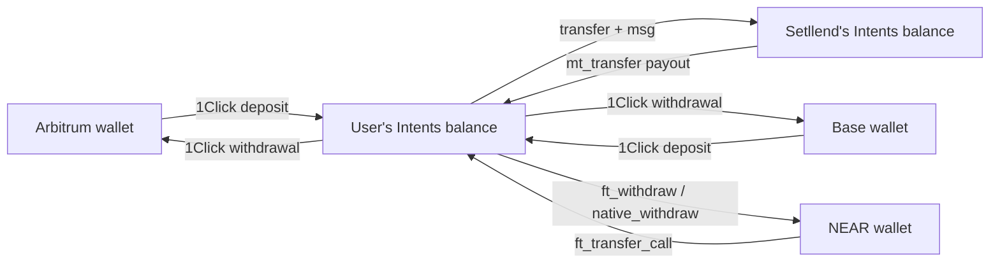

All Setllend money lives on the `intents.near` ledger. It arrives there from Base or Arbitrum through **1Click**, or straight from a NEAR wallet. Inside, it moves between the user's **Intents balance** and the Setllend contract's balance on the same ledger. It leaves through 1Click to Base or Arbitrum, or with a withdrawal intent to a NEAR account.

## Assets

| Asset | Origin | Decimals | Intents asset ID | Role in Setllend |
|---|---|---|---|---|
| USDC | NEAR (native) | 6 | `nep141:17208628f84f5d6ad33f0da3bbbeb27ffcb398eac501a31bd6ad2011e36133a1` | The debt token: every loan, note, and order is in this USDC |
| ETH | Arbitrum | 18 | `nep141:arb.omft.near` | Collateral |
| ETH | Base | 18 | `nep141:base.omft.near` | Collateral |
| NEAR | NEAR (wrapped, wNEAR) | 24 | `nep141:wrap.near` | Collateral |
| USDC | Base | 6 | `nep141:base-0x833589fcd6edb6e08f4c7c32d4f71b54bda02913.omft.near` | Only on the way in or out: 1Click converts it to or from native NEAR USDC |
| USDC | Arbitrum | 6 | `nep141:arb-0xaf88d065e77c8cc2239327c5edb3a432268e5831.omft.near` | Same as Base USDC |

Amounts are always integers in the token's smallest unit, written as decimal strings: `1000000` is 1 USDC, `1000000000000000000` is 1 ETH. ETH from Arbitrum and ETH from Base are two different tokens on the ledger, priced by the same ETH/USD feed. See [Asset IDs](../developers/asset-ids.md).

## The big picture

## Money inside Setllend

Every movement between a user and the contract is one signed intent. Tokens going in travel with a `transfer` intent and a `msg`; tokens coming out are `mt_transfer` payouts from the contract's balance, triggered by a fill or an `auth_call`.

| Action | Tokens go | When | Signed by |
|---|---|---|---|
| `lend` | USDC: user → Setllend (escrowed in the order) | Order placed | Lender |
| `borrow` | Collateral: user → Setllend (escrowed in the order) | Order placed | Borrower |
| Fill of a `borrow` ask | USDC: the lender's escrow → borrower's Intents balance; collateral: order escrow → the loan, pro rata to the filled principal | Matcher calls `match_orders` | Nobody: permissionless |
| Fill of a `sell_note` ask | USDC: the buyer's escrow → seller's Intents balance; notes: seller → buyer | Matcher calls `match_orders` | Nobody: permissionless |
| `cancel` | The order's remaining escrow → owner | Any time | Order owner |
| `add_collateral` | Collateral: user → the loan | While the loan has debt, until maturity plus the 1-hour grace | Borrower |
| `repay` | USDC: user → the maturity's redemption pool; any excess over the debt is refunded | Any time, also after maturity | Anyone (defaults to repaying the signer's own loan) |
| `withdraw_collateral` | Collateral: the loan → borrower | When the loan stays within max LTV, or has no debt | Borrower |
| `liquidate` | USDC: liquidator → pool; collateral plus bonus: loan → liquidator; unused USDC refunded | Loan unhealthy, or overdue after maturity plus the 1-hour grace | Any liquidator, usually the keeper |
| `redeem` | USDC: pool → note holder | After maturity | Note holder |
| `withdraw` | A free balance (from a failed payout) → user | Any time | The balance's owner |

Two things are worth knowing:

- **A borrower's USDC goes to their Intents balance**, not to a chain. They withdraw it from Portfolio in a separate step (see [Exits](#exits)), or keep it there to repay later.
- **A payout can't be lost.** If an `mt_transfer` from the contract fails, the amount is credited to the user's free balance in the contract and a `payout_failed` event is emitted. The `withdraw` action pays it out again.

For what notes, the pool, and redemption mean, see [Zero-coupon notes](../concepts/zero-coupon-notes.md). For the exact `msg` formats, see [Messages](../developers/contract/messages.md) and [`auth_call` actions](../developers/contract/auth-call.md).

## Deposits from Base and Arbitrum (1Click)

An EVM user deposits USDC or ETH by sending it from their own wallet to a one-time **deposit address** that 1Click creates. 1Click then credits the matching token to the user's Intents balance. Setllend's backend wraps 1Click so the app can quote, track, and display each deposit; the backend never holds the funds.

### How a deposit runs

1. **Quote.** The app asks `POST /api/oneclick/quote` with the direction `deposit`, the asset, the chain, and the amount. The backend asks 1Click for a quote with:
   - `recipientType: INTENTS` and `recipient` = the user's Intents account, always lowercase (`0x…` for an EVM account). This is what makes the funds land on `intents.near` instead of on another chain.
   - `depositType: ORIGIN_CHAIN` and `refundType: ORIGIN_CHAIN`, with `refundTo` = a **refund address** on the origin chain. For an EVM account it defaults to the wallet's own address; a NEAR account must enter one.
   - A deadline. 1Click answers with its own deadline and a `depositAddress` on the origin chain, unique to this quote.
2. **Send.** The user's wallet sends the quoted `amount_in` to the deposit address on Arbitrum or Base: an ERC-20 transfer for USDC, a plain transfer for ETH. This is the only on-chain transaction the user pays gas for, on that chain.
3. **Tell 1Click (optional).** The app passes the transaction hash to `POST /api/oneclick/:id/deposit-tx`, which forwards it so 1Click notices the deposit sooner.
4. **Track.** The backend polls 1Click's status for every open deposit and pushes changes to the app over WebSocket. Statuses are 1Click's: `PENDING_DEPOSIT`, `KNOWN_DEPOSIT_TX`, `PROCESSING`, `INCOMPLETE_DEPOSIT`, `SUCCESS`, `REFUNDED`, `FAILED`. The last three are final.
5. **Arrive.** At `SUCCESS` the tokens are in the user's Intents balance, ready to lend, borrow against, or repay with.

If 1Click can't complete the swap, it refunds to the refund address and the status becomes `REFUNDED`.

### Routes

| Deposit | Arrives as | Default slippage |
|---|---|---|
| USDC from Arbitrum or Base | Native NEAR USDC | 0.5% |
| ETH from Arbitrum | ETH(arb), `nep141:arb.omft.near` | 0.5% |
| ETH from Base | ETH(base), `nep141:base.omft.near` | 0.5% |
| USDC or ETH from Arbitrum or Base, as NEAR | wNEAR, `nep141:wrap.near` (a swap) | 1% |

Most deposits are `EXACT_INPUT`: the user picks how much to send, and the quote shows the estimate and the minimum that arrives. When a deposit funds an order directly (for example "New deposit" in a lend or borrow form), the app uses `EXACT_OUTPUT`: the Intents balance receives exactly the order's amount, the user sends a little more to cover slippage, and 1Click refunds any excess to the refund address after the swap.

### Observed times and fees

These are observations from real-funds tests with $1 of USDC, not guarantees. Times and fees depend on 1Click, its solvers, and the chains.

| Leg | Sent | Received | Cost | Time to `SUCCESS` |
|---|---|---|---|---|
| Deposit: Base USDC → NEAR USDC in Intents | 1.000000 USDC | 0.999798 USDC | 0.000202 USDC, about 2 bps | About 1 minute after the Base transfer |
| Withdrawal: NEAR USDC in Intents → Base USDC | 0.999798 USDC | 0.997196 USDC | 0.002602 USDC, about 26 bps, mostly the withdrawal fee | Within about 30 seconds of signing |
| Deposit: Arbitrum USDC → NEAR USDC in Intents | 1 USDC | 0.999799 USDC | 0.000201 USDC, about 2 bps | About 1 minute after the Arbitrum transfer |
| Withdrawal: NEAR USDC in Intents → Arbitrum USDC | 0.999799 USDC | 0.994297 USDC | 0.0055 USDC, of which the withdrawal fee was 0.0053 USDC | About 15 seconds after signing |

Quotes without moving funds gave similar times: about 25 to 35 seconds for USDC and ETH deposits, and 9 to 12 seconds for USDC and ETH withdrawals.

## Deposits from a NEAR wallet

A NEAR wallet can deposit NEAR or native USDC straight into an Intents balance, with no 1Click. Each deposit is one NEAR transaction from the wallet, which the user approves:

- **NEAR:** the app calls `wrap.near` with `near_deposit` (wrapping NEAR into wNEAR), then `ft_transfer_call` to `intents.near`, both in the same transaction. If the account has no storage on `wrap.near` yet, a `storage_deposit` of 0.00125 NEAR comes first, in the same transaction.
- **USDC:** `ft_transfer_call` on the USDC token contract to `intents.near`.

The `ft_transfer_call` carries `msg` = the Intents account to credit, so the NEAR account's own Intents balance receives it. In the app this is Portfolio → Deposit → From NEAR. See [Deposit](../guides/deposit.md).

:::warning Keep NEAR for gas
NEAR checks that a transaction's whole prepaid gas is on hand before it runs, then refunds what wasn't used. Keep about 0.15 NEAR in the NEAR account beyond what you deposit, or the deposit transaction is refused.
:::

## Exits

### To Base or Arbitrum (1Click)

A withdrawal to another chain is a 1Click swap paid from the Intents balance. The user signs one message and pays no gas.

1. **Quote.** `POST /api/oneclick/quote` with the direction `withdraw`. The 1Click request has `depositType: INTENTS`, `refundType: INTENTS` with `refundTo` = the user's lowercase Intents account, `recipientType: DESTINATION_CHAIN`, and `recipient` = the address on the destination chain (an EVM account's own address by default). Withdrawals are always `EXACT_INPUT`.
2. **Payload.** The backend asks 1Click's `generate-intent` for the payload to sign and checks it before showing it: it must be signed by the user's account, verified by `intents.near`, not expired, and contain exactly one `transfer` of the quoted amount to 1Click's deposit address and nothing else. Any other payload is refused.
3. **Sign.** The user signs the payload unchanged: ERC-191 for an EVM wallet, NEP-413 for a NEAR wallet.
4. **Submit.** `POST /api/oneclick/:id/submit` sends the signed payload to 1Click, which executes the transfer on `intents.near` and delivers the tokens on the destination chain. The status is tracked as for deposits.

| Withdrawal | Arrives as | Default slippage |
|---|---|---|
| USDC | USDC on Arbitrum or Base | 0.5% |
| ETH(arb) | ETH on Arbitrum only | 0.5% |
| ETH(base) | ETH on Base only | 0.5% |
| NEAR (wNEAR) | USDC on Arbitrum or Base (a swap) | 1% |

ETH collateral leaves to the chain it came from. Native NEAR USDC has no same-asset route to Base or Arbitrum, so a USDC withdrawal is always a 1Click conversion.

### To a NEAR account

A NEAR account can take USDC or NEAR out of its Intents balance to itself with one signed intent, sent through the relayer, without 1Click:

- **USDC:** an `ft_withdraw` intent. The account must be registered on the USDC token contract first; the app does this once with "Register on USDC (first time only, 0.00125 NEAR)", a `storage_deposit` from the wallet.
- **NEAR:** a `native_withdraw` intent. It takes wNEAR from the Intents balance and delivers native NEAR, unwrapped.

The relayer only relays these to the signer's own account, and checks that the receiver can take the tokens before submitting, because some failed withdrawals are not refunded by `intents.near`. A NEAR account can also choose a 1Click withdrawal to Base or Arbitrum, entering the `0x` address to receive on. See [Withdraw](../guides/withdraw.md).

## Fees

| Fee | Amount | Charged by |
|---|---|---|
| Setllend | None. The contract takes no fee on orders, fills, repayments, or redemptions, and the backend adds no app fee to 1Click quotes | — |
| NEAR Intents protocol fee | 1 pip (0.0001%) | `intents.near` |
| 1Click | With Setllend's partner key: 0.01% (1 bp) on stablecoin and same-asset routes, which covers every USDC and ETH route above; 0.20% on other swaps, such as to or from NEAR. Withdrawals also carry a `withdrawFee` that 1Click quotes in the withdrawn token | 1Click |
| Gas on NEAR | Paid by the relayer for every signed intent | Setllend's operator |
| Gas on Base or Arbitrum | Paid by the user's wallet for the deposit transfer | The origin chain |
| Gas on NEAR for a NEAR wallet's own transactions | Key registration, deposits from the wallet, USDC storage registration | The user's NEAR account |

Interest is not a fee: it is the difference between a loan's principal and its debt face, paid by the borrower to the note holders. See [Rates and prices](../concepts/rates-and-prices.mdx).
