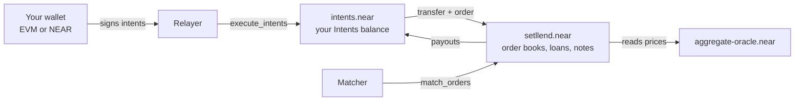

Setllend lets you lend and borrow USDC at a **fixed rate until a fixed date**, from Arbitrum, Base, or NEAR. You sign in with any EVM wallet (MetaMask, Rabby, and others) or a NEAR wallet, and you are never locked in: a lender can sell their position before the end date, and a borrower can repay at any time.

Built for the NEAR Hackathon, Setllend has been live on NEAR mainnet since 2026-11-06.

## What Setllend is

Every loan on Setllend is a **zero-coupon note**: a claim to receive 1 USDC at a fixed date, called the **maturity**.

- **Lending** means buying notes for less than their face value. You pay 1,000 USDC today and receive, for example, 1,003.45 USDC at maturity. The difference is your fixed interest.
- **Borrowing** means issuing notes against collateral. You receive 1,000 USDC today and owe a fixed amount at maturity, for example 1,004.60 USDC.

Rates are quoted as a fixed APR (annual percentage rate). Interest is simple interest on a 365-day year, so the amount owed at maturity is known the moment an order fills: `principal × (1 + APR × days / 365)`.

Lend orders and borrow orders meet on one **order book** per maturity. When a lender's minimum rate is at or below a borrower's maximum rate, the orders cross and fill at the rate of the order that was in the book first. Collateral is ETH (bridged from Arbitrum or from Base) and NEAR. USDC is the only asset you lend or borrow.

Everything settles on [NEAR Intents](how-it-works/near-intents.md), the shared ledger on the `intents.near` contract. Your funds sit in your own **Intents balance** on that ledger until you sign an action. Each action is a signed message (an intent), not a transaction you pay gas for: Setllend's relayer submits it and pays the gas.

## Why it exists

- **Most DeFi loans are variable rate with no end date.** A borrower cannot know what the loan will cost, and a lender cannot know what it will earn. NEAR had no fixed-rate lending market.
- **Classic fixed-rate lending locks the lender in.** Funds stay in the loan until it ends.
- **Setllend removes the lock.** Because a loan is a note on an order book, the same book serves new loans and the resale of existing ones. A lender who wants out sells the note to another lender. A borrower who wants out early buys notes back, which cancels the debt.

## Key properties

| Property | What it means for you |
|---|---|
| Fixed rate, fixed date | The amount you receive or owe at maturity is set when your order fills and never changes. |
| Exit early as a lender | Sell your notes on the same book at any time before maturity ([Exit early](guides/exit-early.md)). |
| Repay early as a borrower | Repay part or all of the debt at any time, or buy notes back through a lend order in the same maturity, which is cheaper before maturity ([Manage a loan](guides/manage-loan.md)). |
| No operator custody | Your funds move only through intents you signed and `intents.near` verified, or through a liquidation if your loan becomes unhealthy or overdue. The relayer only submits what you signed; it cannot change it or sign for you. |
| Permissionless matching | Orders and their escrow live in the contract. Anyone can rebuild the book from chain state and call `match_orders`. The contract checks every fill, and the fill rate is the resting order's rate, not something a matcher chooses. |
| Gasless for EVM users | An EVM account signs messages only. It never needs a NEAR wallet or NEAR tokens. |
| Any chain in, any chain out | Deposits and withdrawals to Arbitrum and Base go through 1Click, the NEAR Intents swap service. A NEAR account can also deposit and withdraw directly. |

Setllend has no admin pause. If the price oracle is stale, new loans, liquidations, and collateral withdrawals against open debt wait, while repaying, adding collateral, placing and cancelling orders, selling notes, redeeming, and other withdrawals keep working. The contract owner can add collateral tokens and change their risk parameters, and those changes apply at once to open loans. The contract account also keeps a full-access key, so its code can be upgraded. See the [trust model](how-it-works/trust-model.md) and [risks](how-it-works/risks.md).

## Live on mainnet

| | |
|---|---|
| App | https://www.setllend.xyz |
| Contract | [`setllend.near`](https://nearblocks.io/address/setllend.near) on NEAR mainnet, deployed 2026-11-06 ([deploy transaction](https://nearblocks.io/txns/DgAcsj1cjT2TnrNNt4e2hAtHauBpdaN6CYovTKpfLkPn)) |
| Source of the deployed code | Commit [`49fcc47`](https://github.com/TarasBrilian/setllend/tree/49fcc47e0167b7a7b4958078a3fedb07354bbd90), a reproducible build: the contract's `contract_source_metadata` view names the commit and the build image ([verify it yourself](verify/verify-contract.md)) |
| Backend API | https://setllend-production.up.railway.app/health |
| Source code | https://github.com/TarasBrilian/setllend (MIT license) |

Markets at launch: USDC with ETH (from Arbitrum or Base) and NEAR as collateral, each at 70% max LTV, 80% liquidation threshold, and a 5% liquidation bonus. The open maturities are listed on the app's Market page. Full values are in [risk parameters](reference/risk-parameters.md).

## Where to go next

| You are | Start here |
|---|---|
| A lender or borrower | [Quick start](getting-started/quick-start.md), then [Wallets and accounts](getting-started/wallets.md) and the guides, starting with [Deposit](guides/deposit.md). |
| New to fixed-rate lending | [Zero-coupon notes](concepts/zero-coupon-notes.md), [Rates and prices](concepts/rates-and-prices.mdx), and [Collateral and health](concepts/collateral-and-health.mdx). |
| A developer or integrator | [Contract overview](developers/contract/overview.md), [Signing intents](developers/signing-intents.mdx), and the [REST API](developers/rest-api.md). |
| An auditor or judge | [Architecture](how-it-works/architecture.md), [Trust model](how-it-works/trust-model.md), and [Verify the contract](verify/verify-contract.md). |
